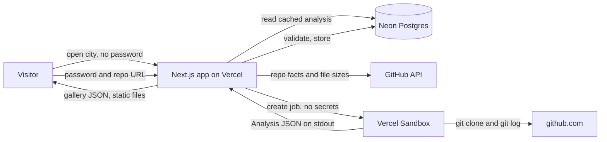
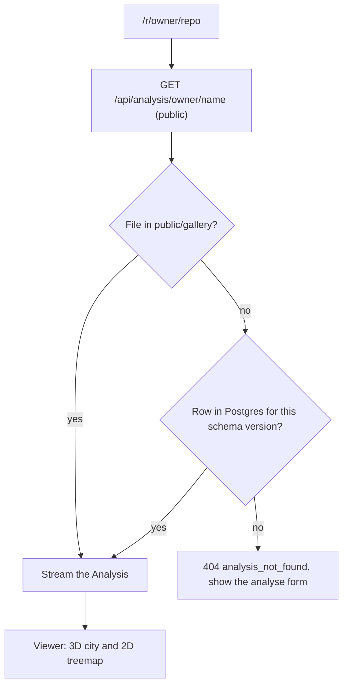
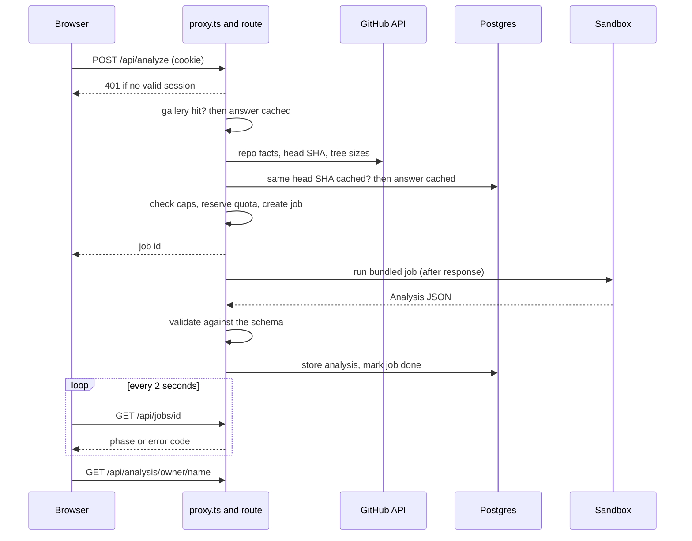
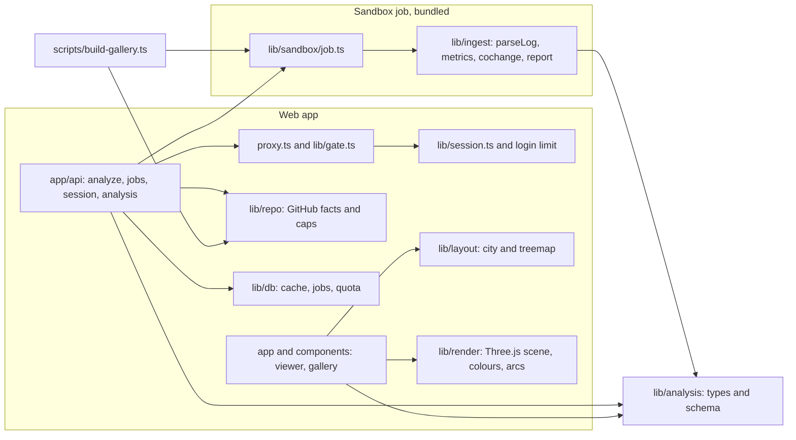
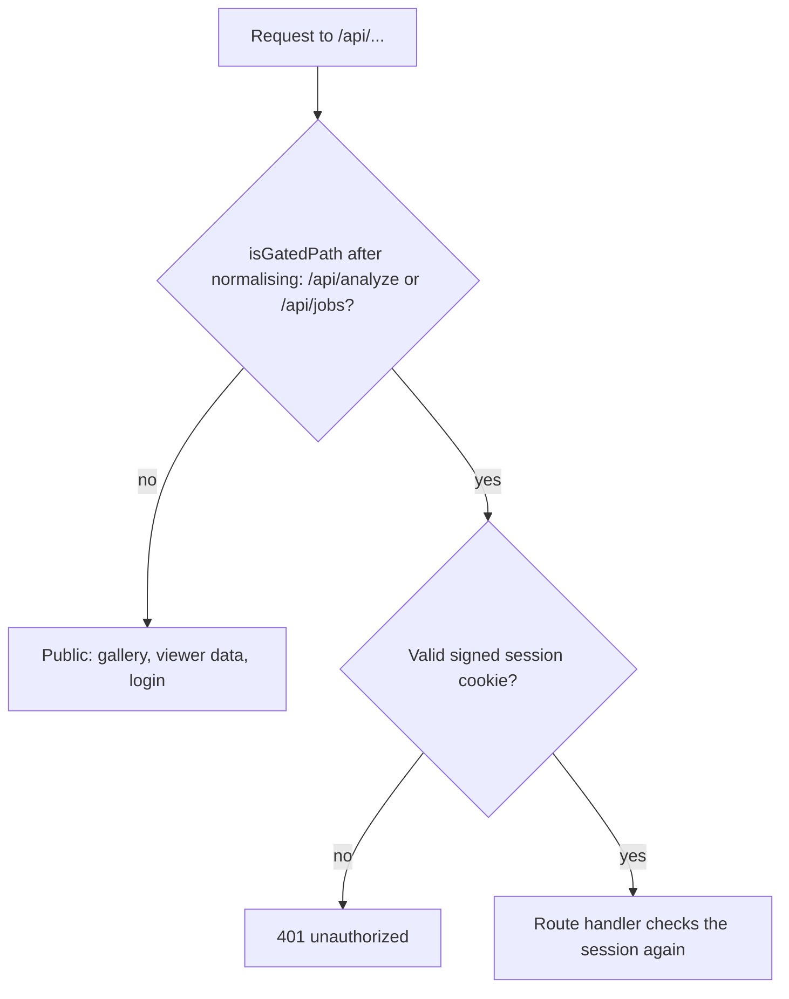

# Architecture

Diagrams for Codebase City as built. The reasoning and the safety rules are in `docs/superpowers/specs/2026-11-13-codebase-city-design.md` (sections 5, 6 and 10).

## System context

## Where the viewer reads data

The viewer never calls GitHub or starts a job. A repo that is not cached shows the password prompt.

## Live analysis flow

## Modules

## Access gate

