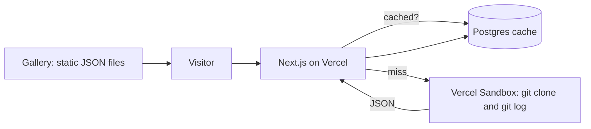

# Codebase City: Interview Guide

**Last updated:** 2026-11-25
**Last plan covered:** `docs/superpowers/plans/2026-11-13-codebase-city.md`, Tasks 0 to 16, all merged (viewer PR 19 and PR 20, gallery and packaging PR 21), plus the two post-launch fixes PR 26 (height scale) and PR 27 (layout cell). Production is live at <https://codebase-city-spike.vercel.app>. Sections 1 to 6 below were first written on 2026-11-18; entries 7 to 12, the process and bug sections were added on 2026-11-25 from the executor notes and PRs.

Everything here is drawn from the project's own artifacts: `docs/requirements-seed.md`, `docs/adr/ADR-001-host-on-vercel.md`, and the 2026-11-13 design conversation. Claims from web sources are marked **verified** (read on the vendor's own page or measured by us), **secondary** (a blog or aggregator) or **unverified**. Re-check any of them before quoting a number in an interview.

---

## 1. What We Built

Paste a public GitHub repo URL and get a 3D city plus a 2D treemap of its files, coloured by hotspot, churn, age, bug-fix density, language and ownership, with co-change arcs for the selected file and a report card of files to read first. The honest value statement from the seed: real but modest, mainly for unfamiliar repos. It is a portfolio showcase.

**Built and measured (figures dated 2026-11-18 unless stated):**

* Live in production since 2026-11-19 on Vercel Hobby (see concept 7). Markus's live check afterwards: everything works; after PR 27 he said the city "looks much better" (executor notes).
* Seven gallery repos, pre-analysed to static JSON: express, vite, svelte, django, cargo, vue core and the-fourth-official. `facebook/react` was chosen too but now redirects to `react/react` (the GitHub API answers 301, which the build treats as not found) and is about 1.15 GB (1,151,225 KB) on GitHub, over the 1,048,576 KB cap, so it was dropped, not substituted.
* Analysis size: the largest gallery file is `sveltejs/svelte` at 2,677,731 bytes (2.55 MiB, about 32% of the 8 MiB bound; the bound was owed a re-measure in Task 9). Others: django 1.83 MB, cargo 0.88 MB, vite 0.86 MB, vue core 0.22 MB, express 0.06 MB, the-fourth-official 0.04 MB. So real repos near the 10,000-file cap stay well under the bound; only a dense synthetic case approaches it.
* Rendering: 60 fps measured on a typical laptop with hardware acceleration (600 frames, p99 17 ms), auto-orbit, 5,000 buildings, hotspot colouring (Markus, one run, 2026-11-17).
* Load: on a local dev server, the svelte analysis (2.68 MB, uncompressed) is fetched in about 0.15 s and the viewer page is interactive in about 2 s from a cold navigation (software-rendered browser pane, dev mode); both 2D and 3D views load. Production load figures are not measured.
* Gate: with no cookie the gallery, viewer page and `/api/analysis/...` return 200; `POST /api/analyze` and `GET /api/jobs/...` return 401 (checked locally with fake secrets).
* Tests: 43 files, 824 tests as of 2026-11-18 (PR 26 and PR 27 added more; recount before quoting); a test fails if a gallery file has an out-of-date `schemaVersion`.
* Odd result worth knowing: the vite card shows "Image" as its top language (by bytes), a side effect of language-by-extension.

## Spec deviations (decided during the build)

| Spec said | Built | Why |
| --- | --- | --- |
| Luminance test: minimum adjacent gap 0.1 | 0.03 from 2026-11-17, plus a monotonic cold-to-hot check; 0.05 from 2026-11-26, plus a check that the dimmest stop of each ramp is at least 2:1 against the floor plate | The approved Night Ember ramp had adjacent gaps from 0.031 to 0.363; the lifted ramp (PR 35) has gaps from 0.059 to 0.241 |
| `ArcLayer.tsx` overlay for co-change arcs | Arcs drawn inside the Three.js scene (`lib/render/arcs.ts`) | An overlay needs per-frame projection of 3D points while orbiting; in-scene arcs follow the camera for free |
| Ownership mode ranks the top 8 authors by file-touches | Ranks by files an author mainly owns | Accepted by Markus on 2026-11-18 |
| A re-analyse option behind the password | Deferred for v1, then built in PR 33 as "Check for new commits" (live analyses, unlocked visitors) | A cached POST for a gallery repo or an unchanged head cannot refresh anyway; Markus decided on it after first-use feedback |
| 2D district hover tooltip | Landed in PR 20 | Task 15a had documented it as a decision to skip; reversed as a small follow-up |

## Future improvements and known limits

Markus's first-use feedback on the PR 19 preview (2026-11-18, "works well, likes it") produced three of the items below (home gallery, district labels, password flow); as of 2026-11-26 all three are built and merged (PRs 29, 31 and 33). Re-analyse was a separate decision, deferred by Markus on 2026-11-18 and built in PR 33.

* Built since this list was written: re-analyse a cached repo ("Check for new commits", PR 33), live analyses in the home gallery (PR 29), district labels (PR 31), unlock-first password flow (PR 33), and per-IP limits on `POST /api/analyze` (PR 30; 20 lookups an hour, 5 new analyses a day per IP), which closed the old "GitHub calls happen before the quota check" gap.
* Probe that a spoofed `x-vercel-forwarded-for` header cannot defeat the login limit; the README still lists this as unverified after the deploy.
* Sandbox network policy was checked with `curl` only; a clone under the policy, and that other hosts are blocked, were not separately proven (README, executor notes). Sandbox CPU time per job is not measured, so the quota caps are estimates.
* Colour and accessibility: legend covers about 45% of a phone screen; two greys look alike under achromatopsia; the lifted cold end is still only 2.1:1 against the floor (concept 11). Hand checks still owed: real phone touch, screen reader, true OS reduced-motion, forced-colours.
* Heuristics, not truth: rename history splits (rename detection is off), bug-fix density is a regex over commit subjects, a 24-month window (README, known limitations).
* Dependabot ignore rule for `@types/node` majors; TypeScript 7 held until typescript-eslint supports it; ESLint 9 deprecation.

## 2. Tech stack

| Layer | Choice | Status |
| ----- | ------ | ------ |
| Hosting | Vercel (ADR-001) | Decided 2026-11-13; production deployed 2026-11-19 on Hobby |
| Git analysis | Plain TypeScript module, run inside a Vercel Sandbox | Built (Tasks 3 to 9); Sandbox spike passed 2026-11-14 |
| Database / cache | Postgres via a Vercel Marketplace partner; Neon (see the note below the table) | Neon chosen as lowest-effort option, 2026-11-17 |
| Front end | Next.js with Three.js and a 2D treemap | Built (Tasks 13 to 15b, PR 19 and PR 20) |
| Access model | Public gallery of cached cities; adding a new repo is password-protected | Decided 2026-11-13 (Markus: "make it public, while the adding of repos password protected"); tier is Standard (confirmed by Markus 2026-11-13), with a security review on the ingestion boundary and the gate |

Neon: Postgres was the requirement; Neon was the lowest-effort Vercel Marketplace option and, being plain Postgres, is portable by changing DATABASE_URL; no written comparison against other providers.

---

## 3. Hosting: Vercel vs Railway

### Which build approach is Vercel? (A, B or C from the design discussion)

* **A:** web app plus a separate always-on worker with a queue (BullMQ, Redis).
* **B:** one deployable app that does the git work itself, no queue or separate worker.
* **C:** client-only, GitHub API from the browser (rejected: rate limits make per-file history impossible).

The Vercel design is **B-shaped (ADR-001 calls it B3)**: one Next.js app, no queue, no Redis, no standing worker service. The difference from plain B is where git runs: in a disposable Sandbox microVM created per job, instead of a child process in the web server. A Sandbox does play the role of a worker, but it lives only for one job, so there is nothing to keep running or to put a queue in front of. It is not C, because git runs server-side.

### Side by side

| | Vercel | Railway |
| - | ------ | ------- |
| Model | Serverless: short-lived functions, no permanent disk | PaaS running containers that stay up |
| Best for | Next.js, static and cached front ends, preview deploys | Long-running workers, queues, WebSockets, non-JavaScript stacks (for example Spring Boot) |
| Databases | Partner Postgres via Marketplace (no Postgres of its own) | Postgres and Redis as services beside your app, private network |
| Running git on untrusted repos | Needs Vercel Sandbox (disposable microVM per job) | Plain container, or Railway Sandboxes (reported opt-in beta, unverified) |
| Idle cost | $0 | Uses resources while running; Serverless setting can sleep a service after about 10 minutes idle |
| Pricing (verified from Vercel's pricing page) | Hobby $0. Pro $20 a month per developer seat, with a $20 usage credit | Markus pays $5 a month (Railway Hobby plan). Credit and per-resource rates not re-checked |
| Over the limit | Hobby: hard cap, feature pauses, no bill. Pro: pay-as-you-go, uncapped | Billed by usage |
| Function limits | Hobby 300 s default and max; Pro 800 s max (a beta 1800 s exists) (secondary) | None for a container beyond your own timeout |
| MCP server | Yes, official remote server at `mcp.vercel.com`, OAuth (secondary) | Yes, the Railway MCP (used in other projects) |
| Security incident | April 2026: third-party AI tool compromise led to access to non-"sensitive" environment variables; closed 2026-10-16 per Vercel | October 20 to 22, 2026: attacker reached internal systems, may have decrypted some stored secrets; all users told to rotate |

### How a live analysis flows

On Railway the Sandbox box would simply be the web process (plain B) or a second secret-free service.

### Why people pick Railway over Vercel
Long-running processes, non-JavaScript stacks, databases in the same project, cost that follows a container's resources, no function time limit, and a mental model that matches running a server locally. This is my reading of how the platforms work, not a survey.

### Why we picked Vercel for this project
$0 idle, strongest isolation for untrusted repos, static gallery fits well, and an explicit goal of exploring a platform not used before. Not because Railway can't do it: Railway can run the same disposable-box design, and plain Railway is less to build.

### Could Railway run the same design? (yes)

The Vercel design (approach B with a per-job Sandbox) maps onto Railway almost one to one:

| Piece | On Vercel | On Railway |
| ----- | --------- | ---------- |
| Web app and gallery | Next.js, gallery as static files | Next.js service; gallery served by it |
| Per-job disposable box | Vercel Sandbox (microVM) | Railway Sandbox: isolated, short-lived Linux VM; create, exec, destroy (reported opt-in beta in July 2026, unverified) |
| Cache | Marketplace Postgres (for example Neon) | Postgres service in the same project |
| Idle cost | $0 | Web service uses credit while running; the Serverless setting can sleep it after about 10 minutes idle, with a slow first request (some users report failures; unverified) |
| Network for the box | Policy can be restricted | Outbound-only by default; can join the private network, which Railway advises against for untrusted code |
| Fallback without sandboxes | None needed | Plain B (git as a child process), or a second secret-free service (always on, shared disk across jobs, so weaker isolation) |

A Railway caveat: the older Serverless reference says private networking does not work with sleeping, which matters if the web service calls a separate ingest service. Check before relying on that combination.

### How to justify the choice in an interview

An honest, defensible answer, in order of weight:

1. **The technical fit was equal.** Both platforms can run a disposable box per job. I did not choose Vercel because Railway couldn't do it.
2. **Cost shape.** Vercel Hobby is $0 idle with a hard cap; at 3 to 5 demos a month I'd use a small share of every allowance. Railway would use credit for an always-on web service.
3. **Consolidation.** The Fourth Official, a Next.js app, is the only Railway service known to be live (chat-app's worker and Redis have an unknown running state; see the workspace deployed-services file), and wedding-invitation is already documented on Vercel. Moving it could end the $5 plan. Not done yet.
4. **Learning goal.** I chose a platform I hadn't used for this workload, to broaden what I can talk about.
5. **Trade-off I accepted.** More code (create, wait, collect, clean up) and a newer product; a spike gated the dependency and passed (2026-11-14), with Railway as the fallback if that ever changes.
6. **What would have made me pick Railway.** If chat-app or FrontRow came back (workers, Redis, Spring Boot), or if the spike had failed, or if I wanted the least code to ship in a week.

**Interview talking point:** "Either platform could run the design, so I decided on cost shape, consolidation and what I wanted to learn, not on capability. I kept the git logic a plain module, so if Sandbox ever stopped fitting (the spike passed on 2026-11-14), moving to Railway would be a small change."

---

## 4. Technical concepts

### 1. Serverless vs a container platform

**Simple version:** Railway is like renting a small computer that stays on. Vercel is like a pop-up kitchen that appears when an order comes in and disappears after.

**The longer version:** Vercel runs your code as short-lived functions that start per request, with no permanent disk and a maximum duration. That is cheap and scales to zero but is a poor fit for a long `git clone`, and whether the function runtime even has the `git` binary is something I did not verify. Railway runs a container that stays up (optionally sleeping when idle), so a child-process `git clone` just works. Vercel's answer for that case is Sandbox: a separate, disposable microVM you create from your code for one job.

**Interview talking point:** "Vercel is serverless, so each request is a short-lived function with no disk. Cloning a repo doesn't fit that, so I run the git work in a Vercel Sandbox, a disposable microVM, and cache the result. Railway would let me run it as a child process in a long-lived container, which is simpler, but I chose Vercel for the isolation and the idle cost, and to learn it."

### 2. Why untrusted git work needs isolation

**Simple version:** you're opening a stranger's package. You do it in a room with no valuables.

**The longer version:** the tool clones user-supplied repositories. The design never checks out files or executes repo content, uses a URL allowlist (`https://github.com/...` only), size checks, timeouts and per-job cleanup. A Sandbox adds a second layer: the job runs in a fresh microVM with a restricted network policy (to be verified in the spike), so even if something went wrong it holds no database credentials. On a single Railway service, git would run next to the web service's secrets, so we would rely on our own safeguards, or add a second secret-free service.

**Interview talking point:** "The risky part of the product is cloning repos I didn't write. Defence in depth: never check files out or run anything, validate the URL and size up front, time-box the job, and run it somewhere that holds no secrets. A disposable VM per job gives that last layer by default."

### 3. The blobless clone trap (measured)

**Simple version:** asking git for a list is quick. Asking it for sizes makes it download every file one at a time.

**The longer version:** the seed suggested a blobless clone (history, no file contents). We tested it on express (6,186 commits): `git log --name-only` took 40 seconds and `git ls-tree -r -l` (file sizes) took 125 seconds, because both lazily fetch file contents one by one. `git log --numstat` was stopped after about 3 minutes. `git log --no-renames --name-only` took **0.23 seconds**, and `git ls-tree -r HEAD` without `-l` took 0.06 seconds. The cost: with rename detection off, a renamed file's history splits at the rename. File sizes need another source, such as the GitHub trees API (one call; unauthenticated limit 60 requests an hour) or one batched fetch.

**Interview talking point:** "I didn't trust the blobless-clone idea, so I measured it. The default log command took 40 seconds on a 6,000-commit repo because rename detection fetches file contents one at a time. With rename detection off it took a quarter of a second. I accepted the trade-off that renames split a file's history, and I'd document that as a known limitation."

### 4. Cost model and what a hard cap means

**Simple version:** Hobby is a free meal with a fixed plate: when it's empty you stop eating, you don't get a bill. Pro is a tab that keeps running.

**The longer version:** Vercel Hobby (verified, Vercel pricing page): $0, 100 GB bandwidth, 1M function invocations, 4 hours Active CPU, 360 GB-hours memory a month, and no way to buy more. Pro: $20 a month per seat with a $20 credit and pay-as-you-go overage, uncapped. Sandbox on Hobby gives 5 Active CPU hours a month (Vercel docs, checked in the 2026-11 spike). Our estimate for 3 to 5 demos a month at 5 uncached repos each: about 50 minutes of Sandbox time against the 5 CPU hours (300 CPU-minutes). The caps allow up to 60 jobs a month at about 2 minutes each, which is 120 minutes of wall time. Whether that fits 5 CPU hours (300 CPU-minutes) depends on CPU time, which the spike did not measure (it timed one clone and log at about 1 s, not a full job); on 2 vCPUs the worst case is 240 CPU-minutes, on 4 vCPUs 480, so Task 9 must measure it. That is the worst case, when every job is a cache miss. Bandwidth is a few percent, and negligible function memory for the Fourth Official. These are estimates, not measurements. The real risk is bots or an exposed link, which is why live analysis could sit behind a password with a public static gallery.

**Interview talking point:** "I sized the free tier before choosing it. At a few demos a month I'd use about a sixth of the Sandbox allowance (about 50 of 300 CPU-minutes, assuming jobs run on 1 vCPU, which the spike did not record), the worst case the caps allow (60 uncached jobs, about 120 minutes of wall time) could use 40% of it or, on 4 vCPUs with busy jobs, exceed it, which I would measure before relying on it, and the free plan's hard cap means the failure mode is a paused feature, not a surprise bill. The one thing that could change that is abuse of a public endpoint, so I'd gate the expensive path."

### 5. Platform reputation and incidents

**Simple version:** both providers had a serious security incident in 2026; neither is a risk-free choice.

**The longer version:** Vercel is the larger and more widely recognised, as the maker of Next.js. In April 2026 attackers compromised a third-party AI tool's OAuth app, took over a Vercel employee account and read customer environment variables not marked "sensitive". Vercel's bulletin says remediation completed and the incident closed on 2026-10-16. Railway disclosed an incident on 2026-10-21: an attacker reached internal systems and may have decrypted some customers' stored secrets, and users were told to rotate everything stored before that date. Details of the dollar or workspace impact in blogs are unverified. The lesson that applies to this project: mark secrets as sensitive, keep few of them, and keep a record of where each lives (the workspace already does this in `docs/deployed-services.md`).

**Interview talking point:** "I don't treat either provider as safe by default. Both had incidents this year, so I minimise the secrets each holds, mark them sensitive, and know where every secret lives so rotation is a checklist, not a hunt."

### 6. Public gallery plus a password gate on adding repos (decided)

**Simple version:** a museum with two doors. One is open and shows finished cities. The other, to analyse a new repo, needs a password.

**The longer version:** the gallery is static JSON built ahead of time, so a view is about 1 to 3 MB of transfer (estimate) and no server work; 100 GB of Hobby bandwidth is about 30,000 views. The password gate protects the costly path from bots and strangers and could reuse the `DEMO_PASSWORD` and `SESSION_SECRET` pattern from the Fourth Official. It raises a tier question: the global tiering lists auth as Mandatory, so the design should decide whether a shared demo password counts.

**Privacy note:** author keys in the data are pseudonymous: an unsalted 12-character hash of an email can be matched against a known address, so never describe them as anonymised or as "no personal data". Display names containing `@` are cut at the `@`, and visitor IPs are kept only as keyed hashes: for the login limit and the GitHub lookup counters up to an hour, and for the per-IP daily analysis counter up to a UTC day (Markus accepted a day on 2026-11-25, because a daily limit needs a daily window).

**Interview talking point:** "Anyone can fly through pre-analysed cities for free. Pasting a new repo, the expensive and riskier part, is behind a shared password, which keeps costs and exposure bounded."

### 7. Production deploy: one shared database, existing secrets

**Simple version:** for a demo, I moved into the house with the furniture I already had instead of buying a second set for the guest room.

**The longer version:** Production went live on 2026-11-19 at `codebase-city-spike.vercel.app` on Vercel Hobby. Production and Preview share the same Neon database and reuse the existing secrets. Markus decided this on 2026-11-19, the day of the first production deploy, as the simplest route for a demo; a separate database for Production was the cleaner alternative he declined (executor session confirmation, 2026-11-25). Preview and Production use the same `DATABASE_URL` (`vercel env ls` shows it set for Development, Preview and Production), so a Preview deploy can read and write production cache, jobs and quota rows, and a bad preview build can affect the live site. `docs/deployed-services.md` in the workspace was updated at deploy time.

**Interview talking point:** "I shared one Neon database and the existing secrets between Production and Preview because it was the simplest route for a demo. I know the clean answer is a separate database for Production, and I'd do that before real users: a preview should not be able to touch production rows."

### 8. Scaling height: the 98th percentile, not the maximum (PR 26)

**Simple version:** if one skyscraper is 500 times taller than everything else, a city drawn to fit it makes every other building a paving stone.

**The longer version:** building height was `sqrt(size / largest file)`. On cargo the largest file is 2,449,408 B, the 98th percentile is 50,759 B and the median is 673 B, so the median building was 0.41 cells tall and the city looked flat. The fix uses the 98th-percentile size as the reference, caps the share at 1 and raises the minimum height from 0.25 to 0.4. Cargo's median went from 0.41 to 1.51 cells; about 2% of buildings share the maximum height by design (cargo: 62 of 3,092). For 50 files or fewer the percentile equals the maximum, so small repos behave as before. Not tuned beyond cargo, django, express, svelte, vite and vue core. Evidence: PR 26 and `height-scaling-report.md` in the executor notes.

**Interview talking point:** "A single outlier file was setting the scale for the whole city. I switched the reference to the 98th percentile and clamped, so the biggest few percent of files tie at the top and everything else uses the range. It's a judgment call I validated on six repos, not a tuned constant."

### 9. The layout cell collapse (PR 27): a bug the tests were blind to

**Simple version:** the fix for "buildings are too short" didn't work, because the real problem was the plot size they stood on, and my tests measured everything in plot units.

**The longer version:** after PR 26 cargo still rendered flat. The city layout shrinks one shared building cell by a factor of 0.9 until every district's grid fits. Cargo has `tests/build-std`, a one-file district squeezed beside the huge `tests/testsuite` into a sliver about 79.6 x 0.006 world units. It could never fit, so the loop ran 31 times and the cell ended at 0.038 on a 110.6-unit floor: buildings about 1/3,000 of the floor width, tallest 0.38 where 10 was intended. Other repos shrank 1 to 8 steps for the same reason (1 to 2 file districts such as `.github/actions`), so they were dim copies of the same bug. The loop's 200-step guard was never reached, so nothing flagged it. Fix: floor the shared cell at 0.6, and give a district that still cannot fit at the floor double treemap weight and re-run the layout (at most 12 passes), with a last-resort per-district cell that fuzzing of 3,600 cities never reached. Cargo's cell went from 0.038 to 1.00 and its tallest building from 0.38 to 10.0; django and express were byte-identical before and after.

**Lesson:** the PR 26 tests asserted heights in cell units, so they passed while the world-unit result was wrong. Assert on the quantity a viewer sees (size relative to the floor), not only on the intermediate. Second lesson: PR 26 was expected to fix cargo and did not; the executor notes record telling Markus so.

**Interview talking point:** "My first fix passed its tests and didn't fix the picture. The tests were in cell units and the defect was in world units: one 0.006-wide sliver district made a shrink loop run 31 times. I reproduced it on the real repo, floored the cell and gave districts that can't fit more area, and compared before and after numbers across all seven gallery repos."

### 10. Quota refunds: refund only before the Sandbox exists

**Simple version:** if the restaurant never cooked your meal you get your token back; if the kitchen cooked it and you dropped it, the token is spent.

**The longer version:** live analyses reserve one unit of a shared quota that protects the Hobby Sandbox allowance. The first design refunded the unit on any late failure. The security reviewer on the DB layer flagged that this lets a password holder burn Sandbox CPU with deliberately failing runs while the counters stay at zero. Markus decided on 2026-11-16 (binding, spec section 6 and section 15): refund only when the run fails before the Sandbox is created; every failure after that keeps the unit, and a `timeout` always keeps it. A `sandbox_started` flag on the job row is written when `create()` returns, and `failJob` releases in one row-locked statement, so a release happens exactly once. Known accepted gap: if the database is down for both the flag write and the failing write, the stale-job sweep later refunds that one unit.

**Interview talking point:** "A refund rule is a security decision. Refunding every failure meant failing runs were free, so I refunded only what never reached the Sandbox. I put the rule in one row-locked statement so it can't double-refund, and wrote down the one edge case I accepted."

### 11. Night Ember palette and accessibility choices

**Simple version:** heat colours that go from cold purple to hot yellow, with a text legend, because colour alone is not enough.

**The longer version:** the sequential modes (hotspot, churn, age, bug-fix) use the Night Ember ramp `#8c2367 #b83854 #dc5537 #f57c16 #f9ad22 #fbd956 #fcffa3`, an inferno-style ramp chosen on 2026-11-17 for legibility on a dark background and lifted at the cold end on 2026-11-26 (PR 35; the first version, `#280b54 #65156e #9f2a63 #d44842 #f57d15 #fac127 #fcffa4`, had a darkest stop of 1.04:1 against the floor `#131a2e`); language and ownership use the colour-blind-safe Okabe-Ito categorical palette. The spec's luminance test (minimum adjacent gap 0.1) was changed to 0.03 plus a monotonic cold-to-hot check, because the original ramp's adjacent gaps ran from 0.031 to 0.363; after the lift it is 0.05 (the new gaps run from 0.059 to 0.241), plus a check that the dimmest stop of each ramp is at least 2:1 against the floor. A later pass (`pr19-verify-report.md`) found a keyboard-only pass and a reduced-motion pass (using a `matchMedia` override, not the OS setting) both passing, and found real defects: Escape did not close the phone sheet after tapping the canvas, and the "no activity" grey is hard to tell from the 0.50 hotspot colour under achromatopsia (dE2000 about 3). The darkest ramp colour had about 1.05:1 contrast with the page background (`task-14-report.md`), so low-activity buildings nearly vanished (the second stop was 1.55:1); the 2026-11-26 lift (PR 35) raised the darkest stop to 2.10:1 and the second to 3.07:1 along the same hue path, and the "others" grey in the categorical palette went from `#999999` to `#bdbdbd` because the old grey was about 1.9 from the pink `#CC79A7` under deuteranopia (now 11.8). The no-activity grey is unchanged, and the test that keeps it at least 6 away from every ramp stop covers protanopia, deuteranopia and tritanopia but not achromatopsia (the grey has no hue to separate), so the achromatopsia weakness above is not fixed by the lift and the lifted stops were not re-measured for it. Legends and tooltips carry the meaning in text, so colour is never the only channel.

**Interview talking point:** "I treated accessibility as testable: a luminance-gap test on the ramp, colour-blind-safe categorical colours, and a text legend. I also lowered the test threshold on purpose and recorded why, and when a contrast check showed the darkest stop was 1.04:1 against the floor, I lifted the ramp and added a 2:1 floor test. Verification found a real keyboard bug and a grey that collapses under achromatopsia, which is on the improvements list rather than hidden."

### 12. Gallery selection

**Simple version:** the gallery is a curated set; a repo that can't pass the same limits as a live analysis doesn't get in.

**The longer version:** eight repos were chosen and seven shipped (express, vite, svelte, django, cargo, vue core, the-fourth-official). `facebook/react` was dropped, not substituted, for the two reasons in section 1: it redirects to `react/react`, and at about 1.15 GB it is over the 1 GB cap, so it would fail the live path too. The build uses unauthenticated GitHub (about 29 s for all eight). A gallery repo is served as a cache hit with no GitHub call, no quota use and no re-analysis. The vite card shows "Image" as its top language, a known side effect of language-by-extension.

**Interview talking point:** "I dropped React from the gallery instead of swapping in something similar, because it was over my own size cap. A showcase that breaks its own limits is a worse story than seven repos that all pass."

---

## 5. Engineering process

* Standard-tier project. The brief is one week of Claude Code time; FrontRow's overrun came from backend depth and review ceremony, so scope is the main risk.
* The first branch is `docs/requirements-seed`, not `main`; implementation starts only after the design doc is approved.
* Decisions are recorded as ADRs before moving on (ADR-001: hosting).
* Research before committing: the blobless clone, hosting limits and incident history were looked up and measured, with unverified claims labelled.
* **Review lanes.** Full lane (Standard and Mandatory work): fresh review rounds until the last two each leave 0 open blockers, every fix verified. Light lane (docs, small changes): one fresh round, every fix verified, no second blocker event. PR 26 and PR 27 ran Full: PR 27 had a fresh round 1, a resumed re-check, and an independent fresh round 2 that fuzzed 3,600 cities and left 0 blockers.
* **Why the original reviewer re-checks.** A fixer's own re-run proves the tests pass, not that the finding is closed. Where it ran as designed it paid off: on the DB layer the resumed security check found a new issue introduced by a fix (a release that could fire twice on a lost response), fixed in 8246b98. Honest gaps: for Task 10 the notes say a blocker fix got no resumed check and had to be verified at whole-branch review; for Tasks 15b and 16 the "resumed check" was the author re-running lint, typecheck and tests, which is weaker than a re-check by the reviewer.
* **What review missed and later work found.** The viewer passed review, and a later verification pass found the Escape bug and the achromatopsia grey (concept 11). The height fix passed two review rounds and still left cargo flat (concept 9). Review reads the diff; only running the real repo showed the picture was wrong.
* **Reviewers' parked findings are recorded, not hidden.** Examples: no test reaches the layout fallback branch (PR 27), spec line 131 still says "square-root scale" and a count-weighted treemap (a spec revision needs its own docs branch).

## 6. Bugs and lessons

* **Cargo renders flat (PR 26 then PR 27).** Symptom: tiny buildings. Investigation: reproduced the height scale on real percentiles, shipped the 98th-percentile fix, found cargo still flat. Root cause: a layout shrink loop driven by a 0.006-wide sliver district. Fix: cell floor plus extra weight for districts that cannot fit. Prevention: compare before and after in world units on every gallery repo (concepts 8 and 9).
* **Refund loophole (DB layer review).** Symptom: none in production; a reviewer saw that failing runs were free. Fix and rule: concept 10.
* **Early lesson:** an assumption about which projects are deployed where was wrong until the deployed-services file was read. Check the record before reasoning from memory.

---

## 7. Likely interview questions and where the answer lives

| Question | Where |
| -------- | ----- |
| Why Vercel, not Railway? | Section 3 and concept 1; ADR-001 |
| Isn't cloning untrusted repos dangerous? | Concept 2 |
| How did you decide how to read git history? | Concept 3 |
| What does this cost to run, and what happens if it gets popular? | Concept 4 and concept 6 |
| What would make you switch? | ADR-001, "What would change this decision" |
| Why share one database between Production and Preview? | Concept 7 |
| Cargo looked flat; what happened? | Concepts 8 and 9, section 6 |
| Can someone with the password burn your quota? | Concept 10 |
| How accessible is it, honestly? | Concept 11, "Future improvements and known limits" |
| How do you review, and what did review miss? | Section 5 |
| What's still unproven? | Production load figures, Sandbox CPU time per job, and untested corners of the spike (Fluid compute off, the 300 s limit itself, git clone under the network policy). Settled by the 2026-11 spike: start-up 0.52 s, limits, a continuation to 270 s, egress policy, Hobby terms (personal or non-commercial). Settled: the tier is Standard, confirmed by Markus on 2026-11-13, with a security review on the gate |

## 8. Sources

* Vercel pricing: <https://vercel.com/pricing> (verified)
* Vercel Sandbox pricing and limits: <https://vercel.com/docs/vercel-sandbox/pricing> (secondary for the Hobby figures)
* Vercel Functions limits: <https://vercel.com/docs/functions/limitations> (secondary)
* Vercel MCP: <https://vercel.com/docs/agent-resources/vercel-mcp> (secondary)
* Vercel April 2026 incident: <https://vercel.com/kb/bulletin/vercel-april-2026-security-incident> (summary read via search)
* Railway Serverless: <https://docs.railway.com/deployments/serverless> (summary read via search)
* Railway Sandboxes: <https://docs.railway.com/guides/code-execution-sandboxes> (summary read via search; beta status secondary)
* Railway October 2026 incident: <https://blog.railway.com/p/preliminary-report-october-security-incident> (summary read via search)
