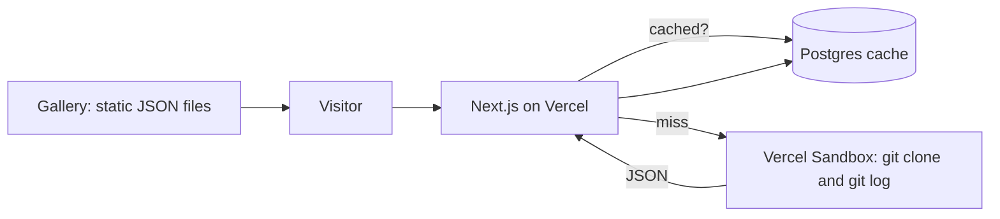

# Codebase City: Interview Guide

**Last updated:** 2026-11-13
**Last plan covered:** none yet. The design is approved and the implementation plan is written (both on the open docs PR); nothing is built. This version records the hosting research, the decision and the design's trade-offs only.

Everything here is drawn from the project's own artifacts: `docs/requirements-seed.md`, `docs/adr/ADR-001-host-on-vercel.md`, and the 2026-11-13 design conversation. Claims from web sources are marked **verified** (read on the vendor's own page or measured by us), **secondary** (a blog or aggregator) or **unverified**. Re-check any of them before quoting a number in an interview.

---

## 1. What We Built

Nothing yet. The plan: paste a public GitHub repo URL and get a 3D city plus a 2D treemap of its files, coloured by hotspot, churn, age, bug-fix density, language and ownership, with co-change arcs and a report card of files to read first. The honest value statement from the seed: real but modest, mainly for unfamiliar repos. It is a portfolio showcase.

## 2. Tech stack

| Layer | Choice | Status |
| ----- | ------ | ------ |
| Hosting | Vercel (ADR-001) | Decided 2026-11-13 |
| Git analysis | Plain TypeScript module, run inside a Vercel Sandbox | Planned; Sandbox spike outstanding |
| Database / cache | Postgres via a Vercel Marketplace partner (for example Neon) | Planned, not chosen |
| Front end | Next.js with Three.js and a 2D treemap | Decided in the design (2026-11-13) |
| Access model | Public gallery of cached cities; adding a new repo is password-protected | Decided 2026-11-13 (Markus: "make it public, while the adding of repos password protected") | Decided; tier is Standard (confirmed by Markus 2026-11-13), with a security review on the ingestion boundary and the gate |

---

## 3. Hosting: Vercel vs Railway

### Which build approach is Vercel? (A, B or C from the design discussion)

* **A:** web app plus a separate always-on worker with a queue (BullMQ, Redis).
* **B:** one deployable app that does the git work itself, no queue or separate worker.
* **C:** client-only, GitHub API from the browser (rejected: rate limits make per-file history impossible).

The Vercel design is **B-shaped (ADR-001 calls it B3)**: one Next.js app, no queue, no Redis, no standing worker service. The difference from plain B is where git runs: in a disposable Sandbox microVM created per job, instead of a child process in the web server. A Sandbox does play the role of a worker, but it lives only for one job, so there is nothing to keep running or to put a queue in front of. It is not C, because git runs server-side.

### Side by side

| | Vercel | Railway |
| - | ------ | ------- |
| Model | Serverless: short-lived functions, no permanent disk | PaaS running containers that stay up |
| Best for | Next.js, static and cached front ends, preview deploys | Long-running workers, queues, WebSockets, non-JavaScript stacks (for example Spring Boot) |
| Databases | Partner Postgres via Marketplace (no Postgres of its own) | Postgres and Redis as services beside your app, private network |
| Running git on untrusted repos | Needs Vercel Sandbox (disposable microVM per job) | Plain container, or Railway Sandboxes (reported opt-in beta, unverified) |
| Idle cost | $0 | Uses resources while running; Serverless setting can sleep a service after about 10 minutes idle |
| Pricing (verified from Vercel's pricing page) | Hobby $0. Pro $20 a month per developer seat, with a $20 usage credit | Markus pays $5 a month (Hobby). Credit and per-resource rates not re-checked |
| Over the limit | Hobby: hard cap, feature pauses, no bill. Pro: pay-as-you-go, uncapped | Billed by usage |
| Function limits | Hobby 300 s default and max; Pro 800 s max (a beta 1800 s exists) (secondary) | None for a container beyond your own timeout |
| MCP server | Yes, official remote server at `mcp.vercel.com`, OAuth (secondary) | Yes, the Railway MCP (used in other projects) |
| Security incident | April 2026: third-party AI tool compromise led to access to non-"sensitive" environment variables; closed 2026-10-16 per Vercel | October 20 to 22, 2026: attacker reached internal systems, may have decrypted some stored secrets; all users told to rotate |

### How a live analysis flows

On Railway the Sandbox box would simply be the web process (plain B) or a second secret-free service.

### Why people pick Railway over Vercel
Long-running processes, non-JavaScript stacks, databases in the same project, cost that follows a container's resources, no function time limit, and a mental model that matches running a server locally. This is my reading of how the platforms work, not a survey.

### Why we picked Vercel for this project
$0 idle, strongest isolation for untrusted repos, static gallery fits well, and an explicit goal of exploring a platform not used before. Not because Railway can't do it: Railway can run the same disposable-box design, and plain Railway is less to build.

### Could Railway run the same design? (yes)

The Vercel design (approach B with a per-job Sandbox) maps onto Railway almost one to one:

| Piece | On Vercel | On Railway |
| ----- | --------- | ---------- |
| Web app and gallery | Next.js, gallery as static files | Next.js service; gallery served by it |
| Per-job disposable box | Vercel Sandbox (microVM) | Railway Sandbox: isolated, short-lived Linux VM; create, exec, destroy (reported opt-in beta in July 2026, unverified) |
| Cache | Marketplace Postgres (for example Neon) | Postgres service in the same project |
| Idle cost | $0 | Web service uses credit while running; the Serverless setting can sleep it after about 10 minutes idle, with a slow first request (some users report failures; unverified) |
| Network for the box | Policy can be restricted | Outbound-only by default; can join the private network, which Railway advises against for untrusted code |
| Fallback without sandboxes | None needed | Plain B (git as a child process), or a second secret-free service (always on, shared disk across jobs, so weaker isolation) |

A Railway caveat: the older Serverless reference says private networking does not work with sleeping, which matters if the web service calls a separate ingest service. Check before relying on that combination.

### How to justify the choice in an interview

An honest, defensible answer, in order of weight:

1. **The technical fit was equal.** Both platforms can run a disposable box per job. I did not choose Vercel because Railway couldn't do it.
2. **Cost shape.** Vercel Hobby is $0 idle with a hard cap; at 3 to 5 demos a month I'd use a small share of every allowance. Railway would use credit for an always-on web service.
3. **Consolidation.** The Fourth Official, a Next.js app, is the only Railway service known to be live (chat-app's worker and Redis have an unknown running state; see the workspace deployed-services file), and wedding-invitation is already documented on Vercel. Moving it could end the $5 plan. Not done yet.
4. **Learning goal.** I chose a platform I hadn't used for this workload, to broaden what I can talk about.
5. **Trade-off I accepted.** More code (create, wait, collect, clean up) and a newer product with limits I hadn't verified, so a spike gates the dependency, with Railway as the fallback.
6. **What would have made me pick Railway.** If chat-app or FrontRow came back (workers, Redis, Spring Boot), or if the spike failed, or if I wanted the least code to ship in a week.

**Interview talking point:** "Either platform could run the design, so I decided on cost shape, consolidation and what I wanted to learn, not on capability. I kept the git logic a plain module, so if the Sandbox spike failed, moving to Railway would be a small change."

---

## 4. Technical concepts

### 1. Serverless vs a container platform

**Simple version:** Railway is like renting a small computer that stays on. Vercel is like a pop-up kitchen that appears when an order comes in and disappears after.

**The longer version:** Vercel runs your code as short-lived functions that start per request, with no permanent disk and a maximum duration. That is cheap and scales to zero but is a poor fit for a long `git clone`, and whether the function runtime even has the `git` binary is something I did not verify. Railway runs a container that stays up (optionally sleeping when idle), so a child-process `git clone` just works. Vercel's answer for that case is Sandbox: a separate, disposable microVM you create from your code for one job.

**Interview talking point:** "Vercel is serverless, so each request is a short-lived function with no disk. Cloning a repo doesn't fit that, so I run the git work in a Vercel Sandbox, a disposable microVM, and cache the result. Railway would let me run it as a child process in a long-lived container, which is simpler, but I chose Vercel for the isolation and the idle cost, and to learn it."

### 2. Why untrusted git work needs isolation

**Simple version:** you're opening a stranger's package. You do it in a room with no valuables.

**The longer version:** the tool clones user-supplied repositories. The design never checks out files or executes repo content, uses a URL allowlist (`https://github.com/...` only), size checks, timeouts and per-job cleanup. A Sandbox adds a second layer: the job runs in a fresh microVM with a restricted network policy (to be verified in the spike), so even if something went wrong it holds no database credentials. On a single Railway service, git would run next to the web service's secrets, so we would rely on our own safeguards, or add a second secret-free service.

**Interview talking point:** "The risky part of the product is cloning repos I didn't write. Defence in depth: never check files out or run anything, validate the URL and size up front, time-box the job, and run it somewhere that holds no secrets. A disposable VM per job gives that last layer by default."

### 3. The blobless clone trap (measured)

**Simple version:** asking git for a list is quick. Asking it for sizes makes it download every file one at a time.

**The longer version:** the seed suggested a blobless clone (history, no file contents). We tested it on express (6,186 commits): `git log --name-only` took 40 seconds and `git ls-tree -r -l` (file sizes) took 125 seconds, because both lazily fetch file contents one by one. `git log --numstat` was stopped after about 3 minutes. `git log --no-renames --name-only` took **0.23 seconds**, and `git ls-tree -r HEAD` without `-l` took 0.06 seconds. The cost: with rename detection off, a renamed file's history splits at the rename. File sizes need another source, such as the GitHub trees API (one call; unauthenticated limit 60 requests an hour) or one batched fetch.

**Interview talking point:** "I didn't trust the blobless-clone idea, so I measured it. The default log command took 40 seconds on a 6,000-commit repo because rename detection fetches file contents one at a time. With rename detection off it took a quarter of a second. I accepted the trade-off that renames split a file's history, and I'd document that as a known limitation."

### 4. Cost model and what a hard cap means

**Simple version:** Hobby is a free meal with a fixed plate: when it's empty you stop eating, you don't get a bill. Pro is a tab that keeps running.

**The longer version:** Vercel Hobby (verified, Vercel pricing page): $0, 100 GB bandwidth, 1M function invocations, 4 hours Active CPU, 360 GB-hours memory a month, and no way to buy more. Pro: $20 a month per seat with a $20 credit and pay-as-you-go overage, uncapped. Sandbox on Hobby reportedly gives about 5 hours of CPU a month (secondary). Our estimate for 3 to 5 demos a month at 5 uncached repos each: about 50 minutes of Sandbox time against roughly 300 (unverified). The caps allow up to 60 jobs a month at about 2 minutes each, which is 120 minutes, about 40% of the reported 300 (unverified); that is the worst case, when every job is a cache miss. Bandwidth is a few percent, and negligible function memory for the Fourth Official. These are estimates, not measurements. The real risk is bots or an exposed link, which is why live analysis could sit behind a password with a public static gallery.

**Interview talking point:** "I sized the free tier before choosing it. At a few demos a month I'd use well under a fifth of the Sandbox allowance, the worst case the caps allow (60 uncached jobs, about 120 minutes) is about 40%, and the free plan's hard cap means the failure mode is a paused feature, not a surprise bill. The one thing that could change that is abuse of a public endpoint, so I'd gate the expensive path."

### 5. Platform reputation and incidents

**Simple version:** both providers had a serious security incident in 2026; neither is a risk-free choice.

**The longer version:** Vercel is the larger and more widely recognised, as the maker of Next.js. In April 2026 attackers compromised a third-party AI tool's OAuth app, took over a Vercel employee account and read customer environment variables not marked "sensitive". Vercel's bulletin says remediation completed and the incident closed on 2026-10-16. Railway disclosed an incident on 2026-10-21: an attacker reached internal systems and may have decrypted some customers' stored secrets, and users were told to rotate everything stored before that date. Details of the dollar or workspace impact in blogs are unverified. The lesson that applies to this project: mark secrets as sensitive, keep few of them, and keep a record of where each lives (the workspace already does this in `docs/deployed-services.md`).

**Interview talking point:** "I don't treat either provider as safe by default. Both had incidents this year, so I minimise the secrets each holds, mark them sensitive, and know where every secret lives so rotation is a checklist, not a hunt."

### 6. Public gallery plus a password gate on adding repos (decided)

**Simple version:** a museum with two doors. One is open and shows finished cities. The other, to analyse a new repo, needs a password.

**The longer version:** the gallery is static JSON built ahead of time, so a view is about 1 to 3 MB of transfer (estimate) and no server work; 100 GB of Hobby bandwidth is about 30,000 views. The password gate protects the costly path from bots and strangers and could reuse the `DEMO_PASSWORD` and `SESSION_SECRET` pattern from the Fourth Official. It raises a tier question: the global tiering lists auth as Mandatory, so the design should decide whether a shared demo password counts.

**Interview talking point:** "Anyone can fly through pre-analysed cities for free. Pasting a new repo, the expensive and riskier part, is behind a shared password, which keeps costs and exposure bounded."

---

## 5. Engineering process

* Standard-tier project. The brief is one week of Claude Code time; FrontRow's overrun came from backend depth and review ceremony, so scope is the main risk.
* The first branch is `docs/requirements-seed`, not `main`; implementation starts only after the design doc is approved.
* Decisions are recorded as ADRs before moving on (ADR-001: hosting).
* Research before committing: the blobless clone, hosting limits and incident history were looked up and measured, with unverified claims labelled.

## 6. Bugs and lessons

None yet. One early lesson: an assumption about "which projects are deployed where" was wrong until the deployed-services file was read. Check the record before reasoning from memory.

---

## 7. Likely interview questions and where the answer lives

| Question | Where |
| -------- | ----- |
| Why Vercel, not Railway? | Section 3 and concept 1; ADR-001 |
| Isn't cloning untrusted repos dangerous? | Concept 2 |
| How did you decide how to read git history? | Concept 3 |
| What does this cost to run, and what happens if it gets popular? | Concept 4 and concept 6 |
| What would make you switch? | ADR-001, "What would change this decision" |
| What's still unproven? | Sandbox spike (start-up time, limits, whether a background continuation can run 240 s, egress policy) and Hobby terms. Settled: the tier is Standard, confirmed by Markus on 2026-11-13, with a security review on the gate |

## 8. Sources

* Vercel pricing: <https://vercel.com/pricing> (verified)
* Vercel Sandbox pricing and limits: <https://vercel.com/docs/vercel-sandbox/pricing> (secondary for the Hobby figures)
* Vercel Functions limits: <https://vercel.com/docs/functions/limitations> (secondary)
* Vercel MCP: <https://vercel.com/docs/agent-resources/vercel-mcp> (secondary)
* Vercel April 2026 incident: <https://vercel.com/kb/bulletin/vercel-april-2026-security-incident> (summary read via search)
* Railway Serverless: <https://docs.railway.com/deployments/serverless> (summary read via search)
* Railway Sandboxes: <https://docs.railway.com/guides/code-execution-sandboxes> (summary read via search; beta status secondary)
* Railway October 2026 incident: <https://blog.railway.com/p/preliminary-report-october-security-incident> (summary read via search)
