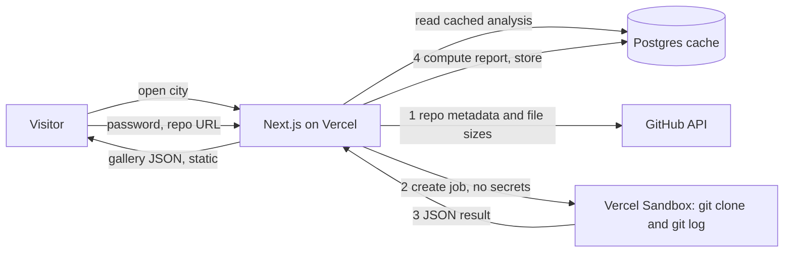

# Codebase City: Design

**Date:** 2026-11-13
**Status:** Approved by Markus on 2026-11-13. Next artifact: the implementation plan (`superpowers:writing-plans`), on this docs branch.
**Inputs:** `docs/requirements-seed.md` (decisions D1 to D7 and the v1 scope are settled and not re-opened here), `docs/adr/ADR-001-host-on-vercel.md`, the 2026-11-13 design conversation.

Attribution: **(Markus)** is a decision or words from Markus. **(my call)** is a choice I made on his behalf; he can overrule any of them. Measured results are marked **(measured)**; web-sourced facts that were not read on the vendor's own page are marked **(unverified)**.

---

## 1. Intent

Paste a public GitHub repo URL and learn quickly where to look in a repo you don't know. The questions the tool answers: which files matter and keep changing, where problems cluster, what is stale, and whether the folder structure shows warning signs. The main purpose is a portfolio showcase for full-stack and AI-engineer applications, built in about one week of Claude Code time. The practical value is real but modest (onboarding, evaluating a dependency, reviewing your own repos); it should not be oversold.

What makes it more than a pretty picture: history-based analysis (hotspots from git churn), ownership, co-change arcs, a 2D view and a report card of files to read first.

## 2. Goals, non-goals, anti-goals

**Goals**
- Public gallery of pre-analysed repos that anyone can open with no setup and fly through. **(Markus)**
- Live analysis of a new repo, protected by a password. **(Markus)**
- 3D city and 2D treemap toggle; colour modes hotspot, churn, age, bug-fix density, language, ownership; click-through details; report card; co-change arcs (seed section 4).
- Costs $0 at demo traffic (3 to 5 demos a month) and fails safe when abused.
- Every heuristic is labelled as a heuristic in the UI.

**Non-goals** (seed): Jira, import and dependency graph, AI features, a "well built" verdict, GitHub issues and PR layer, folder-structure summary, time slider (stretch only).

**Anti-goals** (a failure even if it technically works): a pretty city with no analysis behind it; scope creep past one week; spending Anthropic tokens; running any content from an analysed repo.

## 3. Constraints

- About 5 to 6 days of work. v1 as scoped is already a full week; the time slider is stretch.
- No Anthropic API key. Hosting on Vercel Hobby (ADR-001); allowances are hard caps that pause a feature, not a bill.
- Untrusted repository content is handled on a server. Nothing from a repo is ever checked out or executed.
- Tier: Standard, with a `/security-review` pass on the ingestion boundary and the password gate (my call; see section 12).

## 4. Approaches considered

| | Description | Verdict |
| - | ----------- | ------- |
| **A** | Web app plus separate always-on worker with queue (BullMQ, Redis, Postgres), like chat-app | Rejected: three services to build and review is how FrontRow overran |
| **B1** | One service, git as a child process in the web server (Railway-style) | Simplest, but git runs beside the web service's secrets |
| **B2** | B1 plus a second secret-free ingest service, or Railway Sandboxes | Good isolation; always-on second service (or beta Sandboxes, unverified) |
| **B3** | One Next.js app on Vercel; git runs in a disposable Vercel Sandbox per job | **Chosen (Markus, ADR-001).** Strongest isolation, $0 idle, B-shaped: no queue, no standing worker |
| **C** | Client-only, GitHub API from the browser | Rejected: per-file history needs about one API call per commit; unauthenticated limit is 60 an hour |

The git logic is a plain TypeScript module, so moving to B1 or B2 on Railway is a small change if the Sandbox spike fails. Railway can run the same disposable-box design; see `docs/project-reviewer.md`.

## 5. Architecture

Pieces:
- **Web app:** Next.js (App Router, TypeScript) on Vercel Hobby. Pages: gallery home, city viewer at `/r/<owner>/<repo>`, password gate.
- **Ingestion module (`lib/ingest`):** pure TypeScript, no network, no framework. Input: raw `git log` text plus a file-size map. Output: the `Analysis` object (section 7), including the report card.
- **Sandbox job:** a small script, built from our own repo and bundled with the ingestion module, that runs inside the Sandbox: clone, run the git commands, run the ingestion module, and print only the finished `Analysis` JSON (a few hundred KB to a few MB, not tens of MB of raw log). Inputs (repo, window start, the file-size map) are passed in as arguments or a file. It holds no credentials. The web function does everything that needs a secret (GitHub API calls, database writes) and **validates the returned JSON against a schema before storing it**, so a misbehaving Sandbox cannot poison the cache. **(my call)**
- **Gallery build:** a command-line entry point that does a plain local `git clone` in a temp directory and runs the same ingestion module, with `GITHUB_TOKEN` from the local environment for sizes. Only the ingestion module is shared with the live flow; the clone and size lookup differ, and it is only run on the curated list. **(my call)**
- **Postgres cache** via a Vercel Marketplace partner (for example Neon), keyed by repo, head SHA, window and schema version. Choice of partner is the builder's.
- **Gallery:** static JSON files committed in the repo (`public/gallery/`), generated by the gallery build, same schema as live results. Served from Vercel's network; no function runs. No migration code: when `schemaVersion` changes the gallery is regenerated, and a test fails if any committed gallery file has an out-of-date `schemaVersion`. **(my call)**
- **Cached live analyses** are viewable by anyone with the URL, since the data is public repo data. The gallery page lists only the curated set. **(my call)**

## 6. Live analysis flow and safety

1. Visitor enters a repo in the form. If not signed in, the form asks for the password (signed-in state is a cookie).
2. `POST /api/analyze` validates input, checks the cache. On a hit, returns it immediately.
3. On a miss: check the daily and monthly caps; call the GitHub API for repo metadata, the latest commit date, the total commit count (the `Link` header of `commits?per_page=1`) and the recursive tree (sizes); reject before any clone if over a cap or if the tree is truncated; then create a Sandbox and run the job script.
4. A `jobs` row in Postgres holds the phase (queued, cloning, reading history, computing, done, failed) and an error code. The client polls `GET /api/jobs/<id>` every 2 seconds and shows the phase.
5. On success the web function validates the returned `Analysis` JSON, stores it and marks the job done.

**Clone strategy (my call, to be validated in the spike):** `git clone --filter=blob:none --no-checkout --shallow-since=<latest commit date minus 24 months>`, so the clone is bounded by the window, not by total history. Shallow boundary commits look like "everything added" and would inflate every file's churn, so the ingestion module drops the commits listed in the repo's shallow file. If the spike shows this does not work reliably, fall back to a full blobless history clone with the pre-clone caps below.

**Where the job waits (spike decides):** (a) the web function waits for the Sandbox, bounded by the Hobby function limit of 300 seconds (**unverified**), so the analysis cap is 240 seconds; or (b) the Sandbox runs detached and posts to a signed callback. Default to (a); use (b) only if the spike shows (a) does not fit. **(my call)**

**Safety rules**
- Only `https://github.com/<owner>/<repo>`. The clone URL is built by us from the parsed owner and repo, never passed through from the user. Names must match `^[A-Za-z0-9._-]+$`.
- Clone with `--filter=blob:none --no-checkout`, so no working tree exists and no hook or filter can run. Disable hooks and credential helpers (`-c core.hooksPath=/dev/null`, no terminal prompts). Repo content is only ever read as text output.
- The Sandbox network policy allows only github.com if the product supports it (verify in the spike).
- Pre-clone caps from the GitHub API, so the expensive step never starts for an obvious outlier: repo size, total commit count, files at HEAD, and a truncated tree is a hard reject. Post-clone caps: commits in the window, and the 240-second wall clock. Each failure maps to a specific message (section 11).
- Global caps on live analyses, kept in Postgres, fail closed with "demo limit reached": **10 a day and 60 a month** as starting values. At the roughly 2 minutes of Sandbox time per job assumed earlier, 60 jobs is about 120 of the roughly 300 minutes a month reported for Hobby (**unverified**), leaving headroom. Tune after the spike. **(my call)**
- The viewer route `/r/<owner>/<repo>` validates the name with the same pattern and only reads the cache by key. It never calls GitHub or starts a job; an uncached repo shows the password prompt. There is no cache eviction in v1: 60 analyses a month at about 1 MB each fits a free Postgres tier (**unverified**), and a size check is part of the spike. **(my call)**
- The Sandbox is destroyed after every job, success or not.

## 7. Data

**Git commands (measured on express, 6,186 commits):** the default `git log --name-only` took 40 s and `git ls-tree -r -l` took 125 s on a blobless clone, because both fetch file contents one by one. `git log --no-renames --name-only` took 0.23 s and `git ls-tree -r HEAD` took 0.06 s. So:

- History: `git log --no-merges --no-renames --name-only --format=<hash, author name, author email, unix time, subject>` limited to the window, with `--use-mailmap` if one blob fetch proves acceptable (spike).
- File list at HEAD: `git ls-tree -r HEAD` (no sizes).
- Sizes: GitHub trees API (`git/trees/<sha>?recursive=1`), one call from the web function with a read-only token stored as a sensitive variable. **A truncated tree is a hard reject** ("repo too large"), so every file in a live analysis has a size; there is no "size unknown" case. **(my call)**
- Files at HEAD with no commit in the window stay in the city and the treemap (the cold part of the repo). They have zero churn, no co-change arcs and `lastChanged` set to "older than window", and are coloured with a neutral "no activity in window" grey in every history-based mode. True last-change dates for files older than the window are not computed (that would need a full-history pass or a per-file query). **(my call)**
- **Known limitation:** with rename detection off, a renamed file's history starts at the rename. State this in the UI.

**Window (my call):** last 24 months before the repo's latest commit (not before today, so stale repos still work). Churn and bug-fix counts use the window. "Last changed" can predate the window and is then shown as "older than window".

**`Analysis` shape (schema-versioned JSON)**
- `repo` (owner, name, head SHA, default branch), `window` (from, to, commits counted), `stats` (bug-fix commit share, bot commits excluded, caps hit).
- `files[]`: path, size, language (from extension), `changes`, `lastChanged`, `bugFixes`, top authors with shares (each a hashed key, a display name and a share; **no email address is ever stored or served**, and no commit message beyond the bug-fix count), main author, `coChange[]` (up to 5: path, shared commits, score).
- `report`: `readFirst[]`, `riskiest[]`, `forgotten[]` (10 each, computed server-side so they are deterministic and unit-testable).
- Folders are derived in the browser from file paths.

## 8. Analysis rules (all my calls, all labelled as heuristics in the UI)

- **Hotspot:** percentile rank of `changes` in the repo times percentile rank of `size`, 0 to 1. Rank-based so repo size and outliers do not distort it. Stand-in for "complicated and constantly edited" (D5).
- **Churn:** `changes` in the window, percentile-ranked for colour.
- **Age/staleness:** time since last change, bucketed.
- **Bug-fix density:** commits touching the file whose subject matches `\b(fix(es|ed)?|bug|hotfix|regression|crash|defect)\b` (case-insensitive), excluding subjects matching `typo|lint|format|whitespace|docs?:`; density is bug-fixes divided by changes, shown only for files with at least 3 changes. The UI shows the repo-wide match rate so the noise is visible.
- **Co-change:** only commits touching 30 files or fewer, only files that exist at HEAD, only files with at least 3 changes. Score is shared commits divided by commits touching either file (Jaccard); keep pairs with at least 3 shared commits and score of at least 0.3, top 5 per file.
- **Ownership:** main author is the one with the most commits touching the file in the window. Authors are identified by lowercased email, with GitHub's `<id>+<name>@users.noreply.github.com` form reduced to `<name>@users.noreply.github.com`, but the stored key is only the first 12 hex characters of the SHA-256 of that normalised email, shown with the author's most frequent display name. This is pseudonymisation, not anonymity: names still appear, and a known email can be matched to a key. **(Markus, 2026-11-13: hash them.)** `.mailmap` is applied if the spike shows the extra fetch is cheap, otherwise it is off and the UI says aliases are not merged. Names matching `[bot]`, dependabot, renovate or github-actions are excluded. A district is flagged **single-owner** when one author holds at least 80% of file-touches in it and it has at least 5 changes.
- **Report card:** read-first = 0.5 rank(changes) + 0.3 rank(co-change degree) + 0.2 rank(distinct authors); riskiest = hotspot times bug-fix density (files under 3 changes excluded); forgotten = files with no commit in the window ranked by size, largest first, then files whose last in-window change is the oldest, only files above the median size. Ties are broken by size, then path.

## 9. Rendering

- **Layout:** squarified treemap (d3-hierarchy) for the 2D view, area equals size. For the 3D city, districts are laid out by a treemap of file count, files are equal-footprint buildings in a grid within their district, and height is size on a square-root scale. Both views share the same `Analysis`. **(my call)**
- **3D:** Three.js, one instanced mesh for all buildings, per-instance colour, orbit camera, hover tooltip, search, click for details. Co-change arcs drawn as curves for the selected file only. Library wrapper (plain Three.js or react-three-fiber) is the builder's call.
- **Cap:** at most 5,000 buildings; remaining small files in a folder merge into one "other" building for that district. Target 60 frames a second on a mid laptop with a 5,000 building city.
- **Colour modes:** hotspot, churn, age, bug-fix density, language, ownership, each with a legend and a one-line "this is a heuristic" note.
- **Details panel:** size, changes in window, last changed, bug-fix commits, main author, link to the file on GitHub.
- **Report card:** side panel with the three lists; clicking an entry flies the camera to it.

## 10. Access control

- A shared demo password, checked with the same pattern as the Fourth Official: stateless HMAC-signed session cookie, `DEMO_PASSWORD` and `SESSION_SECRET` as sensitive Vercel variables, constant-time comparison, domain-separated HMACs (`the-fourth-official/lib/session.ts`). Copy the approach, not a dependency. **(my call)**
- Gate covers only `POST /api/analyze`. The gallery, the viewer and cached results are public.
- A visitor who requests a repo that is not cached sees "This repo isn't analysed yet. Enter the demo password to analyse it."

## 11. Error and empty states

Each cap or failure has its own message and no stack trace: not a public GitHub repo; repo too large (shows the cap); too many commits in window; too many files; clone timed out; GitHub API rate-limited; daily demo limit reached; wrong password (rate-limited attempts). A repo with fewer than 20 commits in the window renders but shows a "thin history" note on every history-based colour mode.

## 12. Testing, process and plan

- **Tests:** unit tests for the ingestion module on fixture repos created by a script (init a repo, make scripted commits) so results are deterministic and offline; unit tests for URL validation, the bug-fix matcher, co-change and the session module; a small component test for the colour legend. No test depends on the network. The Sandbox integration is checked by the spike and one manual end-to-end run.
- **Tier:** Standard. Auth is on the global Mandatory list, but this is a single shared demo password with no accounts, no personal data and no spend beyond hosting caps. **Confirmed by Markus on 2026-11-13: Standard**, plus `/security-review` on the ingestion boundary and the gate.
- **Stack-specific setup deferred until this is approved:** formatter hook, test framework, CI, CodeQL, quality baseline (gitleaks, device-path check), C4 diagram, Dependabot npm entry.
- **Rough plan:** Day 0 spike (Sandbox start-up, limits, network policy, whether a function can wait 240 s, how the finished JSON is read back from the Sandbox, whether `--shallow-since` plus dropping boundary commits gives correct churn, `--use-mailmap` cost, size of a stored analysis). Day 1 ingestion module and tests. Days 2 to 3 layout and rendering. Day 4 colour modes, details, report card, co-change arcs. Day 5 ownership, gallery build, gate, deploy, README and demo GIF. Day 6 buffer. Time slider only if Day 6 is free.
- **Demo packaging:** live link, README with demo GIF, Mermaid architecture diagram, decisions and trade-offs section, known limitations (rename history, heuristics, caps), no secrets in the repo.

## 13. Open for the builder

Sandbox job mechanics beyond what the spike shows; Postgres partner; Three.js wrapper; exact caps (starting values: repo size 1 GB by API, 20,000 commits in window, 20,000 files, 5,000 rendered buildings, 240 s) to tune on real repos; which 6 to 8 repos go in the gallery (suggested: a few well-known repos plus Markus's own, chosen to show different shapes); colours and visual styling (run the `design-process` skill before UI work); whether to commit or regenerate gallery JSON.

## 14. Calls made on Markus's behalf, to check while reading

1. 24-month window ending at the latest commit.
2. Rank-based hotspot; thresholds in section 8 for bug-fix, co-change, ownership.
3. Report card formulas.
4. Equal-footprint buildings in a treemap-of-counts city layout.
5. Sizes from the GitHub trees API with a read-only token.
6. Function waits for the Sandbox (cap 240 s), with a callback fallback.
7. Any cached analysis is publicly viewable by URL; gallery lists only curated repos.
8. Shared-password pattern copied from the Fourth Official; Standard tier plus security review.
9. Daily and monthly analysis caps (10 and 60) in Postgres, failing closed.
10. The whole ingestion runs inside the Sandbox; the web function validates the returned JSON.
11. Shallow clone bounded by the window, boundary commits dropped; truncated tree is a hard reject; viewer route only reads the cache.
12. Files with no commits in the window stay in the city in neutral grey; "forgotten" ranks them by size.
13. Gallery JSON is committed and regenerated on a schema bump, enforced by a test; the gallery build is a local clone, sharing only the ingestion module.
14. Author identity is the lowercased email with the GitHub noreply form reduced; `.mailmap` only if cheap. Only a 12-character hash of it is stored, plus a display name (Markus's decision).
