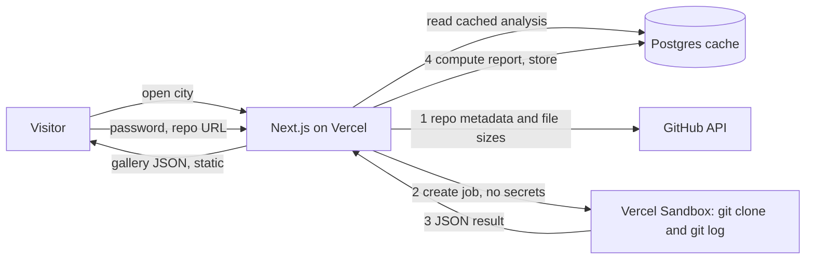

# Codebase City: Design

**Date:** 2026-11-13
**Status:** Approved by Markus on 2026-11-13. The implementation plan is written (`docs/superpowers/plans/2026-11-13-codebase-city.md`) and PR #1 holds both; next is merging the docs PR.
**Inputs:** `docs/requirements-seed.md` (decisions D1 to D7 and the v1 scope are settled and not re-opened here), `docs/adr/ADR-001-host-on-vercel.md`, the 2026-11-13 design conversation.

Attribution: **(Markus)** is a decision or words from Markus. **(my call)** is a choice I made on his behalf; he can overrule any of them. Measured results are marked **(measured)**; web-sourced facts that were not read on the vendor's own page are marked **(unverified)**.

---

## 1. Intent

Paste a public GitHub repo URL and learn quickly where to look in a repo you don't know. The questions the tool answers: which files matter and keep changing, where problems cluster, what is stale, and whether the folder structure shows warning signs. The main purpose is a portfolio showcase for full-stack and AI-engineer applications, built in about one week of Claude Code time. The practical value is real but modest (onboarding, evaluating a dependency, reviewing your own repos); it should not be oversold.

What makes it more than a pretty picture: history-based analysis (hotspots from git churn), ownership, co-change arcs, a 2D view and a report card of files to read first.

## 2. Goals, non-goals, anti-goals

**Goals**
- Public gallery of pre-analysed repos that anyone can open with no setup and fly through. **(Markus)**
- Live analysis of a new repo, protected by a password. **(Markus)**
- 3D city and 2D treemap toggle; colour modes hotspot, churn, age, bug-fix density, language, ownership; click-through details; report card; co-change arcs (seed section 4).
- Costs $0 at demo traffic (3 to 5 demos a month) and fails safe when abused.
- Every heuristic is labelled as a heuristic in the UI.

**Non-goals** (seed): Jira, import and dependency graph, AI features, a "well built" verdict, GitHub issues and PR layer, folder-structure summary, time slider (stretch only).

**Anti-goals** (a failure even if it technically works): a pretty city with no analysis behind it; scope creep past one week; spending Anthropic tokens; running any content from an analysed repo.

## 3. Constraints

- About 5 to 6 days of work. v1 as scoped is already a full week; the time slider is stretch.
- No Anthropic API key. Hosting on Vercel Hobby (ADR-001); allowances are hard caps that pause a feature, not a bill.
- Untrusted repository content is handled on a server. Nothing from a repo is ever checked out or executed.
- Tier: Standard, with a `/security-review` pass on the ingestion boundary and the password gate (my call; see section 12).

## 4. Approaches considered

| | Description | Verdict |
| - | ----------- | ------- |
| **A** | Web app plus separate always-on worker with queue (BullMQ, Redis, Postgres), like chat-app | Rejected: three services to build and review is how FrontRow overran |
| **B1** | One service, git as a child process in the web server (Railway-style) | Simplest, but git runs beside the web service's secrets |
| **B2** | B1 plus a second secret-free ingest service, or Railway Sandboxes | Good isolation; always-on second service (or beta Sandboxes, unverified) |
| **B3** | One Next.js app on Vercel; git runs in a disposable Vercel Sandbox per job | **Chosen (Markus, ADR-001).** Strongest isolation, $0 idle, B-shaped: no queue, no standing worker |
| **C** | Client-only, GitHub API from the browser | Rejected: per-file history needs about one API call per commit; unauthenticated limit is 60 an hour |

The git logic is a plain TypeScript module, so moving to B1 or B2 on Railway is a small change if the Sandbox spike fails. Railway can run the same disposable-box design; see `docs/project-reviewer.md`.

## 5. Architecture

Pieces:
- **Web app:** Next.js (App Router, TypeScript) on Vercel Hobby. Pages: gallery home, city viewer at `/r/<owner>/<repo>`, password gate.
- **Ingestion module (`lib/ingest`):** pure TypeScript, no network, no framework. Input: raw `git log` text plus a file-size map. Output: the `Analysis` object (section 7), including the report card.
- **Sandbox job:** a small script, built from our own repo and bundled with the ingestion module, that runs inside the Sandbox: clone, run the git commands, run the ingestion module, and print only the finished `Analysis` JSON (a few hundred KB to a few MB, not tens of MB of raw log). Inputs (repo, window start, the file-size map) are passed in as arguments or a file. It holds no credentials. The web function does everything that needs a secret (GitHub API calls, database writes) and **validates the returned JSON against a schema before storing it**, so a misbehaving Sandbox cannot poison the cache. **(my call)**
- **Gallery build:** a command-line entry point that does a plain local `git clone` in a temp directory and runs the same ingestion module, with `GITHUB_TOKEN` from the local environment for sizes. Only the ingestion module is shared with the live flow; the clone and size lookup differ, and it is only run on the curated list. **(my call)**
- **Postgres cache** via a Vercel Marketplace partner (for example Neon), keyed by `(owner, name, schemaVersion)` only. Each row stores the `headSha` it was analysed at and `analysedAt`; the window is always the fixed 24 months before that commit, so it is not part of the key. A re-analysis replaces the row, so one repo has one row per schema version. Choice of partner is the builder's. **(my call)**
- **Gallery:** static JSON files committed in the repo (`public/gallery/`), generated by the gallery build, same schema as live results. Served from Vercel's network; no function runs. No migration code: when `schemaVersion` changes the gallery is regenerated, and a test fails if any committed gallery file has an out-of-date `schemaVersion`. **(my call)**
- **Cached live analyses** are viewable by anyone with the URL, since the data is public repo data. The gallery page lists only the curated set. The viewer route `/r/<owner>/<repo>` resolves in this order: the static gallery JSON, then the Postgres row for `(owner, name, schemaVersion)`, else the password prompt. It never calls GitHub. **(my call)**

## 6. Live analysis flow and safety

1. Visitor enters a repo in the form. If not signed in, the form asks for the password (signed-in state is a cookie).
2. Lookup (no password, no GitHub call): the form or viewer resolves the repo as described in section 5 (gallery JSON, then the Postgres row). A stored row is returned as it is and the UI shows "analysed on <date> at <sha>", with a re-analyse option behind the password.
3. `POST /api/analyze` (gated) validates input, then calls the GitHub API for repo metadata, the head SHA, the latest commit date, the total commit count (the `Link` header of `commits?per_page=1`) and the recursive tree (sizes). A repo that is in the static gallery is treated as a cache hit: the gallery result is returned, no quota is used and no re-analysis runs; the gallery is refreshed only by rebuilding it. **(my call)** If the head SHA equals the stored row's `headSha`, it returns the cached result and consumes no quota. Otherwise it rejects before any clone if over a cap or if the tree is truncated, then creates or reuses the job first: if a non-terminal job for the same repo exists, that job's id is returned and **no quota is reserved** (reuse never reserves); only when a new job is created is one unit of the daily and monthly quota reserved. The job row has a `reserved` boolean, set true only after the quota reservation succeeds; if the reservation is refused (daily or monthly limit), the new row is marked failed with the quota error code before returning, so no unreserved non-terminal row is ever reused. A unique partial index on `(owner, name)` over non-terminal jobs means two concurrent first POSTs for the same repo cannot create two rows: the loser re-reads and reuses the winner's job. The reservation date (UTC) is stored on the job row, and a release on failure decrements that stored date's counter, so a job that crosses UTC midnight releases the right day. **(my call)**
4. `POST` creates the `jobs` row, returns the job id immediately and continues the work in the background (see "Where the job waits"). The row holds the phase (queued, cloning, reading history, computing, done, failed) and an error code. The client polls `GET /api/jobs/<id>` every 2 seconds and shows the phase. Job ids are random UUIDs, since the status route is not gated.
5. On success the web function validates the returned `Analysis` JSON, replaces the repo's row (`putCached`) and marks the job done. On failure the reserved quota is released: failed analyses consume no quota. **(my call)**
6. Orphans: a job in a non-terminal phase for more than 5 minutes is treated as failed (code `timeout`) by the next status read, and its quota is released only if the row has `reserved = true`. The Sandbox has its own timeout set to the job deadline at creation, so it cannot outlive a killed web function. **(my call)**

**Clone strategy (my call; validated on express in the spike (one repo, one boundary commit), see `docs/spikes/2026-11-sandbox-spike.md`):** `git clone --filter=blob:none --no-checkout --shallow-since=<latest commit date minus 24 months>`, so the clone is bounded by the window, not by total history. Shallow boundary commits look like "everything added" and would inflate every file's churn, so the ingestion module drops the commits listed in the repo's shallow file. If it ever proves unreliable, the fallback is a full blobless history clone with the pre-clone caps below (the spike measured one on express at 1.35 s).

**Head SHA race (my call):** the GitHub API call and the clone are separate moments, so a push can land between them. The job is given the SHA the API reported and runs `git log` starting from that SHA (not from the clone's current default branch); if that SHA is absent from the clone the job fails with `stale_head`. The runner then checks that the returned `repo.owner`, `repo.name` and `repo.headSha` equal the request, else `invalid_output`. The file list is the GitHub API tree filtered to blobs (directories and submodule entries dropped), the same source as the sizes, so the list and the SHA agree.

**Where the job waits (spike decides):** (a) `POST` creates the job row, returns the job id immediately, and continues the work in `waitUntil` or Next.js `after`; the continuation is bounded by the Hobby function limit of 300 seconds (Vercel docs, with Fluid compute), which the analyse route requests with `export const maxDuration = 300`, so the analysis cap is 240 seconds. **Spike result: (a) holds**: a continuation in `after()` in a route with `maxDuration = 300` ran to 270 s on Hobby (the 300 s limit itself, and whether `maxDuration` or Fluid are strictly required, were not tested). Option (b), a detached Sandbox posting to a signed callback, stays the fallback. **(my call)**

**Safety rules**
- Only `https://github.com/<owner>/<repo>`. The clone URL is built by us from the parsed owner and repo, never passed through from the user. Names must match `^[A-Za-z0-9._-]+$`, must start with an alphanumeric character, and `.` and `..` are rejected; `owner` and `repo` are passed to the job script after `--`. **(my call)**
- Clone with `--filter=blob:none --no-checkout`, so no working tree exists and no hook or filter can run. Disable hooks and credential helpers (`-c core.hooksPath=/dev/null`, no terminal prompts). Repo content is only ever read as text output.
- The Sandbox network policy allows only github.com if the product supports it (verify in the spike).
- Pre-clone caps from the GitHub API, so the expensive step never starts for an obvious outlier: repo size, **total** commit count (starting value 50,000, code `too_many_commits`; new, my call), files at HEAD (starting value 10,000; reduced from 20,000, my call), and a truncated tree is a hard reject. Post-clone caps, enforced by the job: **commits in the window** (20,000, code `too_many_commits_in_window`) and the 240-second wall clock. The two commit caps are separate because a repo with a long history but a small window is cheap with the shallow clone. Each failure maps to a specific message (section 11).
- Global caps on live analyses, kept in Postgres, fail closed with "demo limit reached": **10 a day and 60 a month** as starting values. At the roughly 2 minutes of Sandbox time per job assumed earlier, Hobby's Sandbox quota is 5 Active CPU hours a month (Vercel docs, 2026-09-10; CPU time, so I/O wait does not count, and a job with 2 to 4 vCPUs counts at most 2 to 4 CPU-minutes per wall minute), so 60 jobs of about 2 minutes fit with headroom. The spike measured a clone and log of about 1 s. **(my call)**
- The viewer route `/r/<owner>/<repo>` validates the name with the same pattern and resolves it as in section 5 (gallery JSON, then the Postgres row). It never calls GitHub or starts a job; an uncached repo shows the password prompt.
- There is no cache eviction in v1 (decision stands; one row per repo and schema version, replaced on re-analysis). Storage and response size: the spike (item i) measured only a stand-in on django (1.65 MB) and did not confirm the 8 MB bound, so Task 8 or 9 re-measures; it checked the largest analysis JSON and the API response size against any Vercel response-size limit, and the free-tier storage limit. If the database is full the write fails after the Sandbox run was spent; the job then fails with a clear message and the quota is released. **(my call)**
- The Sandbox is destroyed after every job, success or not, and also has its own timeout (flow step 6).
- Logs and error responses carry error codes and repo names only, never raw stderr, `rawLog`, commit subjects or visitor IPs. **(my call)**
- Payload limits (my call): ingestion truncates author names to 200 characters and skips any file whose path exceeds 1,024 characters, counting those in `stats.capsHit` as `path_too_long`, so one oddly named file does not fail the analysis. Likewise `districts` is truncated to the 2,000 with the most changes, ties broken by path ascending, and `districts_truncated` is recorded in `stats.capsHit` (my call). The `capsHit` codes are `path_too_long` and `districts_truncated`. The schema bounds the total serialised `Analysis` at 8 MB (at about 400 bytes per file, 10,000 files is about 4 MB, under the bound; the spike measures it, and the viewer fetches analyses gzip-compressed, unverified), and the runner caps Sandbox stdout at 8 MB and raises `invalid_output` beyond it.

## 7. Data

**Git commands (measured on express, 6,186 commits):** the default `git log --name-only` took 40 s and `git ls-tree -r -l` took 125 s on a blobless clone, because both fetch file contents one by one. `git log --no-renames --name-only` took 0.23 s and `git ls-tree -r HEAD` took 0.06 s. So:

- History: `git log --no-merges --no-renames --name-only --format=<hash, author name, author email, unix time, subject>` limited to the window, with `-c mailmap.blob=<headSha>:.mailmap --use-mailmap` (the job's SHA, not `HEAD`, so a head race cannot mix commits) (spike: adds about 0.06 s; the `--no-checkout` clone has no working-tree `.mailmap`, so the blob form is required).
- File list at HEAD: the GitHub trees API result filtered to blobs (the same call that gives the sizes), so the list and the head SHA agree; `git ls-tree -r HEAD` stays for the local gallery build, where there is no API tree. **(my call)**
- Sizes: GitHub trees API (`git/trees/<sha>?recursive=1`), one call from the web function with a read-only token stored as a sensitive variable. **A truncated tree is a hard reject** ("repo too large"), so every file in a live analysis has a size; there is no "size unknown" case. **(my call)**
- Files at HEAD with no commit in the window stay in the city and the treemap (the cold part of the repo). They have zero churn, no co-change arcs and `lastChanged` set to "older than window". In **age** mode they are coloured as the stalest bucket and labelled "older than window" (not grey, since age mode is the one that answers "what is outdated"); in hotspot, churn, bug-fix and ownership modes they are coloured with a neutral "no activity in window" grey. **(my call)** True last-change dates for files older than the window are not computed (that would need a full-history pass or a per-file query). **(my call)**
- **Known limitation:** with rename detection off, a renamed file's history starts at the rename. State this in the UI.

**Window (my call):** last 24 months before the repo's latest commit (not before today, so stale repos still work). Churn and bug-fix counts use the window. "Last changed" can predate the window and is then shown as "older than window".

**`Analysis` shape (schema-versioned JSON)**
- `repo` (owner, name, head SHA, default branch), `window` (from, to, commits counted), `stats` (`{bugFixCommitShare, botCommitsExcluded, commitsInWindow, thinHistory, mailmapApplied, capsHit}`).
- `files[]`: path, size, language (from extension), `changes`, `lastChanged`, `bugFixes`, top authors, at most 5 per file, with shares (each a hashed key, a display name and a share; **no email address is ever stored or served**, and no commit message beyond the bug-fix count), main author, `coChange[]` (up to 5: path, shared commits, score).
- `districts[]` (at most 2,000): `{path, singleOwner, ownerKey, ownerName, ownerShare, changes}` for every folder at depth 1 or 2 from the repo root, computed server-side (section 8). **(my call)**
- `report`: `readFirst[]`, `riskiest[]`, `forgotten[]` (10 each, computed server-side so they are deterministic and unit-testable).
- Folders for layout are derived in the browser from file paths; the district ownership flags are not, they come from `districts`.

## 8. Analysis rules (all my calls, all labelled as heuristics in the UI)

- **Hotspot:** percentile rank of `changes` in the repo times percentile rank of `size`, 0 to 1. Rank-based so repo size and outliers do not distort it. Stand-in for "complicated and constantly edited" (D5).
- **Churn:** `changes` in the window, percentile-ranked for colour.
- **Age/staleness:** time since last change, measured from the analysis's `window.to` (the latest commit, so stale repos still show a spread), in buckets: at most 30 days, at most 90, at most 180, at most 365, at most 730, and "older than window" (the stalest; cold files land here). **(my call)**
- **Bug-fix density:** commits touching the file whose subject matches `\b(fix(es|ed)?|bug|hotfix|regression|crash|defect)\b` (case-insensitive), excluding subjects matching `typo|lint|format|whitespace|docs?:`; density is bug-fixes divided by changes, shown only for files with at least 3 changes. The UI shows the repo-wide match rate so the noise is visible.
- **Co-change:** only commits touching 30 files or fewer, only files that exist at HEAD, only files with at least 3 changes. Score is shared commits divided by commits touching either file (Jaccard); keep pairs with at least 3 shared commits and score of at least 0.3, top 5 per file.
- **Ownership:** main author is the one with the most commits touching the file in the window. Authors are identified by lowercased email, with GitHub's `<id>+<name>@users.noreply.github.com` form reduced to `<name>@users.noreply.github.com`, but the stored key is only the first 12 hex characters of the SHA-256 of that normalised email, shown with the author's most frequent display name. A display name containing `@` is reduced to the part before the `@` (my call), so no email address reaches `authors[].name`, `mainAuthor` or `districts[].ownerName`. This is pseudonymisation, not anonymity: names still appear, and a known email can be matched to a key. **(Markus, 2026-11-13: hash them.)** `.mailmap` is applied if the spike shows the extra fetch is cheap, otherwise it is off and the UI says aliases are not merged. Names matching `[bot]`, dependabot, renovate or github-actions are excluded. A **district** is any folder at depth 1 or 2 from the repo root (my call); a district's `changes` sums the files beneath it. A district is flagged **single-owner** when one author holds at least 80% of file-touches in it and it has at least 5 changes. The share is computed from the stored per-file author shares (at most 5 authors per file), so the rule can under-flag, never over-flag.
- **Report card:** read-first = 0.5 rank(changes) + 0.3 rank(co-change degree) + 0.2 rank(distinct authors); riskiest = hotspot times bug-fix density (files under 3 changes excluded); forgotten = files with no commit in the window ranked by size, largest first, then files whose last in-window change is the oldest, only files above the median size. Ties are broken by size, then path.

## 9. Rendering

- **Layout:** squarified treemap (d3-hierarchy) for the 2D view, area equals size, drawn on a canvas 2D context and capped at the same 5,000 rectangles with small files merged (my call). For the 3D city, districts are folders at depth 1 and 2 only (a depth-2 district nests inside its depth-1 parent), matching `Analysis.districts`; files directly in the repo root, and files directly in a depth-1 folder that also has depth-2 subfolders, go into a layout-only pseudo-district named "(files)" under their parent, which is not listed in `Analysis.districts` (my call); districts are laid out by a treemap of file count, files are equal-footprint buildings in a grid within their district, and height is size on a square-root scale. Both views share the same `Analysis`. **(my call)**
- **3D:** Three.js, one instanced mesh for all buildings, per-instance colour, orbit camera, hover tooltip, search, click for details. Co-change arcs drawn as curves for the selected file only. Library wrapper (plain Three.js or react-three-fiber) is the builder's call.
- **Cap:** at most 5,000 buildings **including** the per-district "other" buildings; remaining small files in a folder merge into one "other" building for that district. **(my call)** Target 60 frames a second on a mid laptop with a 5,000 building city.
- **Colour modes:** hotspot, churn, age, bug-fix density, language, ownership, each with a legend and a one-line "this is a heuristic" note. Ownership mode uses distinct colours for the top 8 authors by file-touches and one neutral "others" colour (different from the "no activity" grey), and single-owner districts get a visible outline or badge in both the city and the treemap, explained in the ownership legend. **(my call)** In age mode cold files take the stalest bucket and the legend labels it "older than window"; in the other history-based modes the legend includes the grey "no activity in window" stop. **(my call)**
- **Details panel:** size, changes in window, last changed, bug-fix commits, main author, link to the file on GitHub: `https://github.com/<owner>/<repo>/blob/<headSha>/<path>` with each path segment URL-encoded. Hovering a district shows "single owner: <name> (<share>%)" when flagged.
- **Hostile strings (my call):** file paths, author names and every other repo-derived string render only as React text nodes or `textContent`; no `dangerouslySetInnerHTML` or `innerHTML` anywhere (enforced by ESLint), and tooltips truncate to 200 characters.
- **Report card:** side panel with the three lists; clicking an entry flies the camera to it.

## 10. Access control

- A shared demo password, checked with the same pattern as the Fourth Official: stateless HMAC-signed session cookie, `DEMO_PASSWORD` and `SESSION_SECRET` as sensitive Vercel variables, constant-time comparison, domain-separated HMACs (`the-fourth-official/lib/session.ts`). Copy the approach, not a dependency. **(my call)**
- Gate covers only `POST /api/analyze`. The gallery, the viewer and cached results are public.
- The `POST /api/analyze` route handler verifies the session itself as well as `proxy.ts` (defence in depth), and `DEMO_PASSWORD` must be at least 16 characters, checked at startup. **(my call)**
- The session cookie is `HttpOnly; Secure; SameSite=Lax`, so `POST /api/analyze` cannot be driven cross-site to burn the quota. Wrong-password attempts are limited to 5 a minute per IP, kept in a `login_attempts` table in Postgres (an in-memory counter would not survive serverless instances); the table stores a keyed hash of the IP (HMAC with `SESSION_SECRET`, domain-separated like the session module), never the raw IP, and rows older than 1 hour are purged on each insert (my call); the client IP comes from the platform's forwarded-for header, to be confirmed against Vercel's docs when built (unverified). **(my call)**
- A visitor who requests a repo that is not cached sees "This repo isn't analysed yet. Enter the demo password to analyse it."

## 11. Error and empty states

Each cap or failure has its own code and message, and no message contains a stack trace or an internal path (my call; the Task 12b test asserts both):

| Code | Message |
| ---- | ------- |
| `not_found` | We couldn't find a public GitHub repository with that name. |
| `repo_too_large` | This repository is larger than the 1 GB limit for live analysis. |
| `too_many_commits` | This repository has more than 50,000 commits, which is over the live analysis limit. |
| `too_many_commits_in_window` | This repository has more than 20,000 commits in the last 24 months, which is over the live analysis limit. |
| `too_many_files` | This repository has more than 10,000 files, which is over the live analysis limit. |
| `tree_truncated` | GitHub returned only part of this repository's file list, so it is too large to analyse live. |
| `clone_failed` | We couldn't fetch this repository's history. Please try again. |
| `stale_head` | The repository changed while we were analysing it. Please try again. |
| `invalid_output` | The analysis produced a result we couldn't use, so nothing was saved. Please try again. |
| `timeout` | The analysis took longer than the 4-minute limit and was stopped. |
| `github_rate_limited` | GitHub is limiting requests right now. Please try again in a few minutes. |
| `daily` | The daily demo limit has been reached. Please try again tomorrow (UTC). |
| `monthly` | The monthly demo limit has been reached. Please try again next month. |
| `db_write_failed` | The analysis finished but we couldn't save it, so it did not count against the demo limit. Please try again later. |
| `wrong_password` | That password is not correct. |
| `too_many_attempts` | Too many attempts. Wait a minute and try again. |

A failed database write fails the job with `db_write_failed` and releases the quota. A repo with fewer than 20 commits in the window renders but shows a "thin history" note on every history-based colour mode.

## 12. Testing, process and plan

- **Tests:** unit tests for the ingestion module on fixture repos created by a script (init a repo, make scripted commits) so results are deterministic and offline; unit tests for URL validation, the bug-fix matcher, co-change and the session module; a small component test for the colour legend. No test depends on the network. Database tests run on PGlite (real Postgres compiled to WASM) so the partial unique index and concurrency follow Postgres semantics; PGlite support for partial unique indexes is unverified, with a Testcontainers Postgres as the fallback. **(my call)** The Sandbox integration is checked by the spike and one manual end-to-end run.
- **Tier:** Standard. Auth is on the global Mandatory list, but this is a single shared demo password with no accounts, no personal data beyond visitor IPs (kept only as keyed hashes for up to an hour) and no spend beyond hosting caps. **Confirmed by Markus on 2026-11-13: Standard**, plus `/security-review` on the ingestion boundary and the gate.
- **Stack-specific setup** (formatter hook, test framework, CI, CodeQL, quality baseline with gitleaks and the device-path check, C4 diagram, Dependabot npm entry) is Task 1 of the plan (branch `chore/scaffold`), after the docs PR merges.
- **Rough plan (matches the plan's task order):** Day 0 spike (Task 0: Sandbox start-up, limits, network policy, whether a function's background continuation can run 240 s with `maxDuration` 300 and Fluid compute, how the finished JSON is read back, shallow clone plus dropped boundary commits, `--use-mailmap` cost, size of a stored analysis and of the API response, plus creating the Vercel project, the Marketplace Postgres and the sensitive variable names, and checking the Sandbox job bundle ships with the function). Day 1 Tasks 1 to 8 (scaffold, schema, fixtures, parser, metrics, co-change, report, orchestrator). Day 2 Tasks 9 to 12b (live analysis: Sandbox job and runner, GitHub client and caps, gate, database layer, API routes). Days 3 to 4 Tasks 13 to 15b (viewer: layout, rendering, viewer UI and states). Day 5 Task 16 (gallery, deploy, README). Day 6 buffer. Time slider only if Day 6 is free. **Cut line:** if Task 15b is not finished by the end of Day 4, Markus decides what to cut; candidates are arc polish, search, the 2D view's extras and accessibility extras beyond the minimum. Nothing is cut automatically, and none of the seed's v1 features is cut without his decision. **(my call)**
- **Demo packaging:** live link, README with demo GIF, Mermaid architecture diagram, decisions and trade-offs section, known limitations (rename history, heuristics, caps), no secrets in the repo.

## 13. Open for the builder

Sandbox job mechanics beyond what the spike shows; Postgres partner; Three.js wrapper; exact caps (starting values: repo size 1 GB by API, 50,000 total commits (pre-clone), 20,000 commits in window (post-clone), 10,000 files, 5,000 rendered buildings, 240 s) to tune on real repos; which 6 to 8 repos go in the gallery (suggested: a few well-known repos plus Markus's own, chosen to show different shapes); colours and visual styling (run the `design-process` skill before UI work); whether to commit or regenerate gallery JSON.

## 14. Calls made on Markus's behalf, to check while reading

1. 24-month window ending at the latest commit.
2. Rank-based hotspot; thresholds in section 8 for bug-fix, co-change, ownership.
3. Report card formulas.
4. Equal-footprint buildings in a treemap-of-counts city layout.
5. Sizes from the GitHub trees API with a read-only token.
6. POST returns a job id at once and the work continues in the background (cap 240 s), with a callback fallback.
7. Any cached analysis is publicly viewable by URL; gallery lists only curated repos.
8. Shared-password pattern copied from the Fourth Official; Standard tier plus security review.
9. Daily and monthly analysis caps (10 and 60) in Postgres, failing closed.
10. The whole ingestion runs inside the Sandbox; the web function validates the returned JSON.
11. Shallow clone bounded by the window, boundary commits dropped; truncated tree is a hard reject; viewer route only reads the cache.
12. Files with no commits in the window stay in the city: stalest bucket in age mode, neutral grey elsewhere; "forgotten" ranks them by size.
13. Gallery JSON is committed and regenerated on a schema bump, enforced by a test; the gallery build is a local clone, sharing only the ingestion module.
14. Author identity is the lowercased email with the GitHub noreply form reduced; `.mailmap` only if cheap. Only a 12-character unsalted hash of it is stored (a pseudonymised key, not anonymisation: it can be matched against a known address; no raw email), plus a display name cut at any `@` (Markus's decision on hashing; the `@` cut is my call).
15. Cache keyed by `(owner, name, schemaVersion)` with `headSha` and `analysedAt` stored; viewer resolves gallery JSON, then Postgres, never GitHub; re-analysis replaces the row.
16. Two commit caps: 50,000 total (pre-clone) and 20,000 in the window (post-clone, `too_many_commits_in_window`).
17. Job reuse for the same repo; quota reserved at job start and released on failure; non-terminal jobs older than 5 minutes read as failed; Sandbox timeout equals the job deadline.
18. The job runs `git log` from the API's head SHA and fails `stale_head` if it is absent; the runner checks the returned repo fields.
19. Rate-limit store is a `login_attempts` table; cookie `HttpOnly; Secure; SameSite=Lax`; job ids are random UUIDs.
20. Repo name rule: alphanumeric first character, `.` and `..` rejected, arguments passed after `--`.
21. The 5,000 building cap includes "other" buildings.
22. No cache eviction in v1; a full database fails the job and releases quota.
23. Quota is reserved only when a new job is created (never on reuse), with the reservation date stored on the job row and released against that date.
24. A gated analyse request for a gallery repo is a cache hit (gallery result, no quota); the gallery is refreshed only by rebuilding it.
25. Job row carries a `reserved` flag; a refused reservation fails the new row at once; orphan release only for reserved rows; unique partial index on `(owner, name)` for non-terminal jobs makes concurrent first POSTs share one job.
26. A district is any folder at depth 1 or 2; `Analysis.districts` carries the single-owner flag, shown as an outline or badge and a tooltip.
27. Age buckets (30, 90, 180, 365, 730 days, older than window), measured from `window.to`; ownership palette of 8 authors plus "others".
28. Payload limits: author names truncated to 200, over-long paths skipped as `path_too_long`, 8 MB schema and stdout bounds.
29. Hostile-string rule: repo-derived strings only as text nodes, no `innerHTML`, tooltips cut at 200 characters.
30. The route handler checks the session as well as the proxy; `DEMO_PASSWORD` at least 16 characters.
31. Database tests on PGlite, Testcontainers as the fallback; the stale-job rule also runs inside `createOrReuseJob` and on every POST.
32. The GitHub file link is `https://github.com/<owner>/<repo>/blob/<headSha>/<path>` with encoded segments.
33. `districts` truncated to the 2,000 with the most changes, recorded as `districts_truncated`; the city layout forms districts at depth 1 and 2 only.
34. Day plan follows the task order, with a cut line at the end of Day 4 that Markus decides.
35. Files-at-HEAD cap reduced from 20,000 to 10,000; payload sizing argument (about 400 bytes per file, gzip on fetch).
36. The analyse route sets `maxDuration = 300` and needs Fluid compute (both unverified).
37. Exact error messages and codes, including `stale_head` and `db_write_failed`; the job reports `stale_head` (not `clone_failed`) when the SHA is absent.
38. Districts truncation tie-break is path ascending.
39. Layout-only "(files)" pseudo-districts for root files and files beside depth-2 subfolders; the 2D view is a canvas capped at 5,000 rectangles.
40. Author display names containing `@` are cut at the `@`; the schema rejects `@` in names.
41. `login_attempts` stores a keyed hash of the IP and purges rows older than 1 hour; logs and errors carry codes and repo names only.
42. Spike pass thresholds: Sandbox start at most 20 s median of 5, mailmap at most 5 s, allowance at least 150 minutes and concurrency 2, Node 20 or later.
